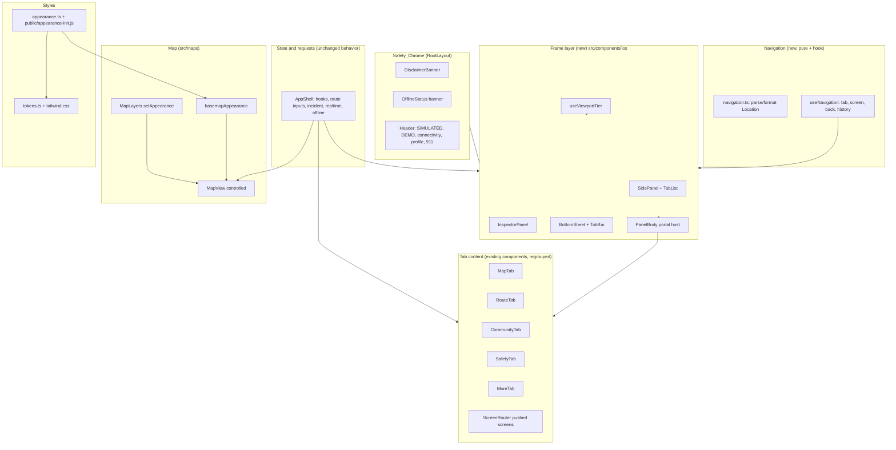
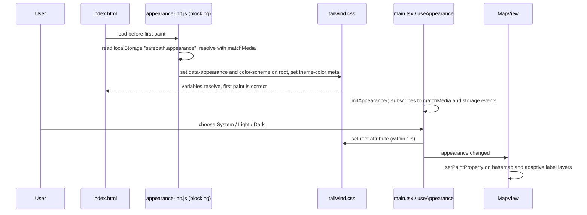

# Design Document

## Overview

This design restyles and rearranges the SafePath Frontend (`safepath/frontend`) into an iOS-style interface with **desktop and widescreen as the primary target** and phones as a fully supported adaptation. Only presentation, layout, styles, and presentation tests change. The Backend_API, the generated API client, and the behavior of `src/hooks` and `src/services` stay as they are (Requirement 1).

The design rests on seven decisions.

| # | Decision | Rationale |
|---|----------|-----------|
| D1 | One state owner, two frames. `AppShell` keeps every hook, state variable, and request as is. A new frame layer renders the same content in a **Side_Panel** (Wide) or a **Bottom_Sheet** (Compact). | Requirement 1.2 and 1.4 forbid behavior change. Moving only the container proves parity by construction. |
| D2 | Colors become runtime CSS variables on `:root[data-appearance]`. Tailwind's `@theme inline` maps the **existing** utility names (`bg-surface`, `text-route`, `border-border-subtle`, ...) to those variables. | Every existing component re-themes without a rewrite. Tailwind v4 documents `@theme inline` for tokens that reference other variables ([Tailwind theme docs](https://tailwindcss.com/docs/configuration/), [SitePoint on dynamic themes](https://www.sitepoint.com/tailwind-css-v4-dynamic-themes/)). |
| D3 | The pre-paint Appearance script is an **external classic script** (`public/appearance-init.js`), not an inline script. A CSS `prefers-color-scheme` fallback covers the case where the script does not run. | The production CSP is `script-src 'self'` (`infrastructure/aws/lib/web-stack.ts`), so an inline script would be blocked. |
| D4 | The basemap switches Appearance by **updating paint properties** on the existing style. The PMTiles source, its URL, and its attribution never change. | `map.setStyle` would drop the source and every data layer, re-request tiles, and break the opt-in offline cache. Paint updates touch none of that. |
| D5 | Only the active tab is mounted. Cross-tab state already lives in `AppShell`. | Avoids duplicate ids and test ids from hidden panels. Route inputs, selection, and incident state survive tab changes today and still do. |
| D6 | Pushed screens keep `role="dialog"` and the `ScreenFrame` contract (title focus, Escape, focus return), but are **non-modal** and no longer trap Tab. | Existing tests query `dialog` by name. A trap would block the Tab_List, which Requirement 6.7 keeps reachable. |
| D7 | The five tabs stay five. No tab is added. | Every Feature_Inventory item maps to exactly one of Map, Route, Community, Safety, More (see the Feature Parity Map). A sixth tab would split a task across tabs rather than group it. Requirement 6.9 records this. |

### Research findings that shape the design

- **Production CSP.** `script-src 'self'` blocks inline scripts. `style-src` allows `'unsafe-inline'`, so inline `style` attributes (used by MapLibre and `MapView`) remain fine. This drives D3.
- **Basemap today.** `src/maps/pmtiles.ts` builds the style. A self-hosted PMTiles file is the production source (raster by default, vector optional). The public OSM raster tiles are a development-only fallback. Production without a file requests no third-party tiles. `MapView` registers the `pmtiles://` protocol, probes the file, and renders its own always-present attribution element (`osm-attribution`). The service worker caches the whole `.pmtiles` file only when the user presses the download button (`src/services/offlineMap.ts`, `src/sw/routing.ts`) and then answers Range requests from it. The cache key is the file URL. Keeping the URL constant across Appearances therefore keeps the cache valid.
- **Raster tiles are light.** The default PMTiles kind is raster (OSM-style imagery). Today the dark navy only shows as the style `background`. A dark Appearance therefore needs dimming of the raster, which MapLibre supports through the raster paint properties `raster-brightness-max`, `raster-saturation`, and `raster-contrast`. Vector PMTiles get full light and dark colors for `background`, `water`, and `roads`.
- **MapLibre APIs used.** `Map#setPaintProperty` for Appearance. `Map#setPadding` ([PaddingOptions](https://www.maplibre.org/maplibre-gl-js/docs/API/type-aliases/PaddingOptions/)) so that the visible map center excludes the area under the panels.
- **Existing tests drive the DOM shape.** `App.test.tsx` and `a11y.test.tsx` render the whole `App` in jsdom (default width 1024, so Wide) with `MapView` stubbed. They query `dialog` by name, `banner`, `main`, one `h1`, named `navigation` landmarks, `complementary` landmarks, the 911 button as the last Tab stop, and unprefixed fixed widths above the viewport (`forcedWidthPx`). The design keeps or deliberately updates each of these (see Testing Strategy).
- **jsdom has no `matchMedia` and no layout.** The viewport hook must fall back to `window.innerWidth` plus the `resize` event. `a11y.test.tsx` already calls `setViewport(320 | 2560)` that way, so the same helper exercises both frames.

## Architecture

### Layers



### Viewport tiers

`useViewportTier()` returns one of three tiers and is the only place that reads the viewport.

| Tier | Width | Frame |
|------|-------|-------|
| `compact` | below 768 px | Bottom_Sheet + Tab_Bar |
| `wide` | 768 to 1279 px | Side_Panel (with Tab_List). Feature inspector shows in the Side_Panel. |
| `desktop` | 1280 px and above | Side_Panel + trailing Inspector_Panel |

Only one frame is in the DOM at a time, which keeps landmarks, `data-testid`s, and ids unique. The hook uses `matchMedia('(min-width: 768px)')` and `(min-width: 1280px)` when available and falls back to `window.innerWidth` with a `resize` listener (jsdom, old browsers). It is read through `useSyncExternalStore`.

### Page structure

The page is a viewport-locked column. The map is the page; panels float over it. Panels scroll internally.

```
<div data-viewport-tier>                       flex column, height 100dvh
  <a class="skip-link" href="#main-content">
  <DisclaimerBanner/>                          in flow, never covered, no controls
  <OfflineStatus banner/>                      in flow, no dismiss (existing)
  <Header role=banner>                         logo, city, DEMO MODE, SIMULATED, connectivity, profile, 911
  <main id="main-content">                     one main landmark
    <session-status strip/>                    existing guest-session message, in flow
    <div data-testid="dashboard" class="stage">   relative, flex-1, min-height 28rem
      <MapView/>                               absolute, fills the stage
      <Frame/>                                 Side_Panel + Inspector_Panel  OR  Bottom_Sheet + Tab_Bar
      <PickHint/>                              over the map, clear of every panel
    </div>
  </main>
</div>
```

- The Disclaimer_Banner, the offline banner, and the header sit **above** the stage in normal flow. Panels are positioned inside the stage, so they cannot cover the Safety_Chrome at any Detent or width (Requirements 3.1, 3.2, 3.6).
- Below `max-height: 500px` (landscape phones, extreme zoom) the page may scroll vertically and the stage keeps a `min-height` of 28 rem, so the stage never collapses to nothing.
- The 911 control moves from a fixed bottom-right `aside` into the header (Requirement 10.3). It stays outside `main`. Its popover is a `section`, not an `aside`, because a complementary landmark nested in the `banner` landmark is an axe best-practice violation.

### Wide frame geometry

All widths come from one pure function, `stageLayout(stageWidth, panelMode, inspectorOpen)`, so the Map_View minimum can be proved by a property test.

```
|12| Side_Panel (360..400, expanded <=720, rail 72) |12|        MapView        |12| Inspector (340..400) |12|
```

- Default Side_Panel width is 400 px. When the remaining Map_View width would drop below 480 px, the Side_Panel narrows toward 360 px and the Inspector_Panel narrows toward 340 px (Side_Panel first, then Inspector_Panel).
- `expanded` grows up to 720 px but never below the point where the Map_View keeps 480 px. When no growth is possible the Expand control is disabled and says so in its accessible description.
- `collapsed` is a 72 px rail with icon-only tabs that keep their accessible names.
- Above 1600 px, text content inside panels and pushed screens is capped at 720 px (`max-w-[45rem]`). The panels themselves do not grow, so at 2560 px the Map_View gets the extra width.
- The Inspector_Panel sits at `right: 12px + 48px` so MapLibre's navigation control (top right) stays reachable, and `bottom: 12px + 28px` so it never covers the attribution (bottom right).
- `MapView` calls `map.setPadding({ left: panelWidth, right: inspectorWidth })` (Wide) or `{ bottom: sheetHeight }` (Compact) so recentering, `fitBounds`, and the initial Chicago center use the visible area. Padding changes are animated with `easeTo` only when motion is allowed.

### Compact frame geometry

```
Stage (relative)
  MapView                       fills
  Bottom_Sheet                  absolute; bottom = tabBarH + attributionH; top limit = stage top
  attribution strip             absolute; bottom = tabBarH; height attributionH (24 px)
  Tab_Bar                       absolute; bottom 0; padding-bottom env(safe-area-inset-bottom)
```

- The attribution sits in a dedicated strip between the Bottom_Sheet and the Tab_Bar, so it is visible at all three Detents (Requirement 3.5). `MapView` positions its attribution element with the CSS variable `--map-attribution-bottom`, which the Compact frame sets to the Tab_Bar height and the Wide frame leaves at 0.
- Detent heights (`detentHeights(available)`): Collapsed 88 px; Half `clamp(280, 50% of available, available - 96)`; Full `available - 8`. `available` is the stage height minus Tab_Bar and attribution strip. If `available` is below 400 px, Half is placed midway between Collapsed and Full so the three Detents stay distinct.
- At Full the map container gets `inert` (and `aria-hidden` as a fallback where `inert` is unsupported), which satisfies Requirement 7.14 without touching the Safety_Chrome.

### Panel body portal (state survives frame changes)

React remounts children when their parent component type changes. To satisfy Requirement 13.8 (resize or rotate across a boundary keeps tab, form input, selection), the tab content renders once into a persistent detached `div` through `createPortal`. The active frame appends that `div` into its body slot in a layout effect. Switching Wide to Compact moves the DOM node; React state is untouched. If a control inside had focus, the frame restores focus to the element with the same `id` after the move. This is the one non-obvious mechanism in the design; a component test covers it.

### Navigation and hash routing

`src/components/shell/navigation.ts` (pure) defines the location grammar. `useNavigation` replaces `useScreenNav`.

```
location := ""            -> tab map
          | "#" | "#/"    -> tab map
          | "#/tab/" tab  -> tab   (map | route | community | safety | more)
          | "#/" screen   -> screen (the 8 ids in screens.ts, plus the alias "#/sources")
          | "#/demo"      -> demo console
          | anything else -> tab map
```

Tab hashes use the `#/tab/` prefix because `#/community` is already a screen id (Requirement 2.2 keeps it resolving to the same content). Each screen has one parent tab, which is the tab the Tab_List highlights while the screen is open:

| Screen | Parent tab | Reached from |
|--------|-----------|--------------|
| `disaster-selection` | Map | Map tab row "Select a disaster"; More row |
| `route-details` | Route | Route tab row "Route details" |
| `submit-report` | Safety | Safety row, Map quick action, indoor "report" |
| `community` | Community | Community tab row "Community communications"; "Request assistance" quick action |
| `incident-overview` | More | More row |
| `safety-check-in` | Safety | Safety row, Map quick action |
| `official-guidance` | Safety | Safety row, Map quick action |
| `data-sources` / `sources` | More | More row |
| `demo` (not in `screens.ts`) | More | More row "Demo console", only when demo mode is on |

Behavior:

- `openTab(tab)` pushes `#/tab/<tab>` and clears any pushed screen. `openScreen(id)` pushes `#/<id>`. Both create history entries, so the browser Back and Forward controls walk the screens in order (Requirement 6.8).
- Each push stores `{ spFrom: <previous location hash> }` in `history.state`. `back()` calls `history.back()` when the previous entry was created by the app, and otherwise replaces the location with the parent tab hash. The back control shows the title of the previous location (a tab title or a screen title from `SCREEN_TITLES`) next to a chevron, and its accessible name is `Back to <title>`, so the visible text is contained in the name and it never collides with the Tab_List entry of the same title.
- A pushed screen that needs an incident keeps the existing `NeedsIncident` message from `ScreenRouter`.
- `useNavigation` does not own the `hashchange` subscription in two places. `AppShell` today reads the hash twice (`useScreenNav` and `useSyncExternalStore`). Both collapse into the hook.

### Escape handling

A small module-level layer stack (`useDismissibleLayer`) lets each closable layer register while open: profile menu, 911 panel, Inspector_Panel, pushed screen. One document-level `keydown` listener closes the top layer on Escape and returns focus to its opener (Requirement 16.7). `ProfileMenu` keeps its own handler, which stops propagation, because it is the innermost layer. `ScreenFrame` loses its private Escape handler and registers a layer instead; its test still passes because the key event bubbles to the document.

### Appearance



- **Setting vs resolved value.** `AppearanceSetting` is `system | light | dark`, stored under `safepath.appearance`. `Appearance` is the resolved `light | dark`, applied as `data-appearance` on `<html>`. When the setting is System, a `matchMedia('(prefers-color-scheme: dark)')` listener re-resolves without a reload (Requirement 5.2).
- **No-script fallback.** CSS defines the dark values on `:root` and, inside `@media (prefers-color-scheme: light)`, the light values on `:root:not([data-appearance])`. If the init script is missing or blocked, System users still get the correct first paint; only an explicit Light or Dark override could flash.
- **Offline.** `public/appearance-init.js` is added to the service worker precache list in `vite.sw-plugin.mjs` (`publicExtras`), so it loads offline.
- **Storage failure.** A thrown `localStorage` access (private mode, blocked storage) falls back to an in-memory value and System.
- **`color-scheme`.** The root sets `color-scheme: light | dark` so native scrollbars, form controls, and the canvas default match.
- **`theme-color`.** The script and the hook update the single `<meta name="theme-color">` to the resolved `--color-base`.

### Map style and Appearance

`buildBasemapStyle(cfg)` gains an optional `appearance` (default `dark`, which reproduces today's output so the existing tests stay valid). A new module `src/maps/basemapAppearance.ts` holds:

- `basemapPaint(appearance, kind)`: a map from basemap layer id to paint properties.
- `applyBasemapAppearance(map, appearance, kind)`: calls `setPaintProperty` for each entry that exists.

| Layer | Dark | Light |
|-------|------|-------|
| `background` | `#0b1220` | `#f2f2f7` |
| vector `water` | `#16324f` | `#aad3df` |
| vector `roads` | `#3a4a6e` | `#b8bcc8` |
| raster `basemap` | `raster-brightness-max 0.55`, `raster-saturation -0.4`, `raster-contrast 0.1` | `raster-brightness-max 1`, `raster-saturation 0`, `raster-contrast 0` |

The raster values are starting points to tune by eye on the real Chicago extract; the structure (paint-only change) is the contract.

`MapLayers` gains `setAppearance(appearance)`. It updates label layers that use the default label color (`elevation-label`, `hazards-label`, `fire-label`, `flood-label`, `cta-stations-label`): dark text with a light halo in Light, and the current light text with a dark halo in Dark. Labels that carry a status color (incident yellow, simulated-station violet) keep their color and dark halo in both Appearances, because the halo supplies the contrast. The route casing keeps the dark navy in both, which separates the cyan route from a light basemap. Route, closure, unverified, and verified colors do not change (Requirement 5.7). `MapLike` gains an optional `setPaintProperty`, so the existing fake map in tests keeps working.

Why this keeps offline caching and attribution intact (Requirements 5.8, 5.9):

- The PMTiles URL, `pmtiles://` source, and `attribution` field are identical in both Appearances. A test asserts the serialized `sources` are deep-equal across Appearances.
- `setPaintProperty` neither refetches tiles nor removes layers, so the service worker's cached file keeps serving Range requests and no network request is issued.
- `MapView` keeps rendering its own `osm-attribution` element, so attribution does not depend on the style. The element uses theme tokens (`bg-surface/90 text-text-primary`) in place of the current hard-coded dark hex values.
- With no PMTiles file in production the style has no sources; only the `background` paint changes. In development the OSM raster fallback is dimmed the same way as PMTiles raster.

### Motion

Tokens: `--dur-fast 150ms`, `--dur-base 250ms`, `--dur-slow 350ms`, easing `cubic-bezier(0.2, 0.8, 0.2, 1)`. Every animated component uses transitions on `transform`, `opacity`, or `height` only, between 150 and 400 ms (Requirement 13.1). The existing global `prefers-reduced-motion` rule in `tailwind.css` already collapses durations to 0.01 ms; this satisfies Requirement 13.2 (instant change). `useReducedMotion()` exposes the same preference to JavaScript so the Bottom_Sheet drag-settle and `easeTo` padding changes skip animation.

### Accessibility approach

- **Landmarks.** `banner` (header), one `main`, `navigation` landmarks with names (`Primary` for the Tab_List and Tab_Bar, `Quick actions`), and `region` landmarks with names for the Side_Panel, Inspector_Panel, and Bottom_Sheet. The panels are regions, not `complementary`, to avoid nested-landmark violations.
- **Tabs.** The Tab_List and Tab_Bar are lists of links or buttons with `aria-current="page"` on the current tab plus a non-color selected state (filled icon, bold label, leading bar). They use ordinary Tab order, not ARIA `tablist`, because they navigate between hash routes.
- **Segmented_Control.** Two variants. `variant="tabs"` renders `tablist`/`tab` with roving tabindex and arrow keys (the Community sections, which keeps the existing `RightSidebarView` tests valid). `variant="radio"` renders `radiogroup`/`radio` (travel mode, Appearance). Both show the selected segment with a check glyph as well as fill.
- **Toggle_Switch.** A native `<input type="checkbox" role="switch">` with a visible label and a text-visible "On" or "Off", so keyboard and screen readers get native behavior.
- **Focus.** One global `:focus-visible` rule: 3 px outline in `--color-route`, 2 px offset. It reads at least 3:1 against both surfaces in both Appearances. `forced-colors` keeps `Highlight`.
- **Focus management.** Pushed screens focus their title on open and return focus to the opener on close (existing `ScreenFrame` behavior). A keyboard shortcut tab change focuses the new tab's first heading and updates an `aria-live="polite"` announcer.
- **Density and targets.** `--target-min` is 44 px under `@media (pointer: coarse)` and 32 px under `(pointer: fine)`. New iOS components size with `min-h-[var(--target-min)]`. Untouched legacy controls keep their `min-h-11` (44 px), which is at least the Fine_Pointer minimum.
- **Hover.** Hover styles live under `@media (hover: hover) and (pointer: fine)` and never reveal content.
- **Text size.** Layout uses `rem`, `minmax`, and wrapping. Panels scroll internally, so 200% text size loses no content.
- **Translucency.** `backdrop-filter: blur(...)` is wrapped in `@supports`. The base rule is an opaque `--glass-fallback` color that reuses a surface token, so the tested contrast pairs apply to the fallback (Requirement 4.5).

## Components and Interfaces

### Style layer (`src/styles`, `public`, `index.html`)

| File | Change |
|------|--------|
| `tokens.ts` | Keep `palette` (dark values, same name and keys, so `styles.ts`, `MapLayers`, and `tokens.test.ts` keep compiling). Add `lightPalette`, `palettes = { dark: palette, light: lightPalette }`, and the type `Appearance`. Add mirrored non-color tokens (`radius`, `space`, `type` scale) for tests. `DISCLAIMER_TEXT` is untouched. |
| `tailwind.css` | `@theme inline { --color-base: var(--base); ... }` for the existing names, plus new names (`--color-control-border`, `--color-glass`). Dark values on `:root`; light values on `:root[data-appearance='light']` and on `:root:not([data-appearance])` inside `prefers-color-scheme: light`. Non-color tokens: radius (`--radius-card 14px`, `--radius-control 12px`), shadow, blur, spacing, type scale, motion, `--target-min`. Existing focus, skip link, reduced-motion, and forced-colors rules stay. |
| `appearance.ts` | Pure: `resolveAppearance(setting, systemDark)`, `parseSetting(raw)`, `serializeSetting`. Effectful: `readSetting(storage)`, `writeSetting`, `applyAppearance(root, appearance)`, `initAppearance()`. Hook: `useAppearance()` returns `{ setting, appearance, setSetting }` via `useSyncExternalStore`. |
| `public/appearance-init.js` | Classic script, about 15 lines, same logic as `appearance.ts`. |
| `index.html` | `<script src="/appearance-init.js"></script>` in `<head>` before the module script. |
| `vite.sw-plugin.mjs` | Add `/appearance-init.js` to `publicExtras`. |

### Shell and navigation (`src/components/shell`)

```ts
export const TAB_IDS = ['map', 'route', 'community', 'safety', 'more'] as const;
export type TabId = (typeof TAB_IDS)[number];
export const TAB_TITLES: Record<TabId, string>;          // 'Map' | 'Route' | 'Community' | 'Safety' | 'More'
export const SCREEN_TAB: Record<ScreenId, TabId>;        // table above
export type NavLocation =
  | { kind: 'tab'; tab: TabId }
  | { kind: 'screen'; screen: ScreenId }
  | { kind: 'demo' };
export function parseLocation(hash: string): NavLocation;  // total: never throws
export function formatLocation(loc: NavLocation): string;  // '#/tab/route', '#/route-details', '#/demo'
export function selectedTab(loc: NavLocation): TabId;      // tab itself, SCREEN_TAB[screen], or 'more' for demo

export function useNavigation(): {
  location: NavLocation;
  tab: TabId;
  screen: ScreenId | null;
  demo: boolean;
  openTab(tab: TabId): void;
  openScreen(id: ScreenId): void;
  openDemo(): void;
  back(): void;
  backLabel: string;
};
```

`screens.ts` keeps its current exports unchanged and gains `TAB_IDS`, `TAB_TITLES`, and `SCREEN_TAB` (or those live in `navigation.ts`; either is fine as long as `screens.ts` exports stay stable for `shell.test.tsx` and `a11y.test.tsx`).

New in `src/components/shell`:

- `AppFrame.tsx`: reads `useViewportTier()` and `useNavigation()`, renders the stage, `MapView`, and the right frame. Receives the five tab contents as render props from `AppShell`.
- `tabs/MapTab.tsx`, `RouteTab.tsx`, `CommunityTab.tsx`, `SafetyTab.tsx`, `MoreTab.tsx`: compose existing components (see Feature Parity Map). Pure composition; they take props and call no API.
- `useKeyboardShortcuts.ts` plus pure `shortcutReducer`: the `g` then digit sequence (Requirement 16).
- `Emergency911Panel.tsx`: becomes the header control and popover. Its text moves to a shared `Emergency911Guidance` so the Safety tab Card shows the same strings.
- `ScreenFrame.tsx`: keeps its props; becomes non-modal (no Tab trap), renders a Large_Title page header and a back control, and registers as a dismissible layer.
- `BottomControls.tsx`: restyled as the Map tab quick action row. The `onRecalculate` prop becomes optional so the Map tab renders four actions while the existing test (five actions) still passes.
- `RightSidebar.tsx`: `RightSidebarView` re-skinned with `SegmentedControl variant="tabs"`. Its props and test ids do not change.
- `ProfileMenu.tsx`: restyled; the `dl` body is extracted as `ProfileDetails` and reused by the More tab.
- `ScreenRouter.tsx`: unchanged mapping from screen id to page. `LeftSidebar.tsx` is retired once its sections are redistributed (see parity map).

### Reusable iOS components (`src/components/ios`)

All are presentational. They take props and children, call no API, use only tokens, and render deterministically (Requirement 15).

| Component | Props (summary) | Notes |
|-----------|-----------------|-------|
| `SidePanel` | `mode`, `onModeChange`, `tabs`, `children`, `layout` | `region` landmark named "SafePath panel". Holds `TabList`, expand and collapse controls, and the scroll area. |
| `TabList` | `tabs: {id, label, icon, badge?}[]`, `current`, `onSelect`, `railOnly` | `nav aria-label="Primary"`. Vertical. Rail mode hides labels visually but keeps names. |
| `InspectorPanel` | `open`, `title`, `onClose`, `children` | `region` named "Map feature details". Close control, Escape layer, focus return to the map region. |
| `TabBar` | same as `TabList`, horizontal | `nav aria-label="Primary"`. Safe-area padding. |
| `BottomSheet` | `detent`, `onDetentChange`, `available`, `title`, `children` | Grabber is a `button` that cycles detents; Arrow Up and Down also step. Pointer drag uses Pointer Events with `setPointerCapture`. `region` named "SafePath panel". |
| `PanelBody` | `children` | Portal host described above. |
| `Card` | `tone?`, `children` | Radius 14 px, shadow or separator. |
| `GroupedList`, `GroupedRow` | `rows`; row has `label`, `value?`, `icon?`, `href` or `onPress`, `trailing?` | Rows are `a` when they navigate (keeps `link` role for tests), `button` otherwise. Chevron is `aria-hidden`; the accessible name is the label only. |
| `SegmentedControl` | `variant: 'tabs' \| 'radio'`, `options`, `value`, `onChange`, `label` | Arrow keys wrap. |
| `ToggleSwitch` | `label`, `checked`, `onChange`, `description?` | Text state "On" or "Off". |
| `PageHeader` | `title`, `large`, `backLabel?`, `onBack?`, `scrollRoot` | Large_Title of at least 28 px; compact inline title appears when the sentinel leaves the scroll root (IntersectionObserver, with a scroll-listener fallback for jsdom). |
| `icons.tsx` | `TabIcon`, `Chevron`, `CheckGlyph` | Inline SVG, `aria-hidden`. |

Hooks in `src/components/ios/hooks`: `useViewportTier`, `useReducedMotion`, `useDismissibleLayer`, `useSheetDrag`. Pure helpers in `src/components/ios/layout.ts`: `viewportTier(width)`, `stageLayout(...)`, `detentHeights(available)`, `nextDetent(d)`, `nearestDetent(heights, y, velocity)`.

### Map (`src/maps`)

- `MapView` becomes **controlled for layer visibility**: it takes `layerVisibility` and `appearance` props and applies changes to `MapLayers`, to the extraction layer, and to `useArtifactLayers`. It no longer renders the `details` panel. It still renders the extraction label chip and the attribution element, both themed with tokens.
- New `useLayerToggles()` hook (extracted from `MapView`'s state) and `MapLayerControls` (Grouped_List of Toggle_Switches plus the existing `Legend`) render in the Map tab. `LayerToggles.tsx` is replaced by this component; its hard-coded hex colors go away.
- `MapView` props gain `viewPadding` (for `setPadding`) and `onReady` is not needed.
- `AppShell` holds the `useLayerToggles()` result and passes `layerVisibility` to `MapView` and `controls` to `MapTab`.

### Tab contents

| Tab | Content (top to bottom) |
|-----|-------------------------|
| **Map** | `ActiveIncident` Card. Quick actions row (`BottomControls`: Report a hazard, Request assistance, Mark safe, View official guidance). `DisasterSelector` (inline, keeps `disaster-selector`). Row "Select a disaster" to the full screen. `MapLayerControls` (layer Toggle_Switches and Legend). Feature inspector when the viewport is below Desktop. Indoor building view when the incident is a building. |
| **Route** | Outcome Card (shelter in place, no verified route, insufficient data, follow official instructions) and `shelter-note`. `StartDestinationPicker` as a Grouped_List. Travel mode Segmented_Control and step-free Toggle_Switch (hidden for indoor, as today). `RouteUncertaintySummary`. `RouteChangeBanner`. Route alternatives (`RoutePanel`). Recalculate action. Row "Route details". |
| **Community** | Segmented_Control (Reports, Messages & notices, Check-ins & assistance) from `RightSidebarView`. Row "Community communications". |
| **Safety** | Rows: Report a hazard, Request assistance, Mark safe, View official guidance. 911 Card. `OfficialGuidance` for the selected hazard. |
| **More** | Rows: Incident overview, Select a disaster, Data sources and limitations, Demo console (demo mode only). `OfficialLinks`. Account details (`ProfileDetails`). Settings group: Appearance Segmented_Control (System, Light, Dark), Keyboard shortcuts Toggle_Switch, and the shortcut list. |

The Route tab shows a text badge ("Updated") on its tab entry when a `RouteChangeBanner` is present and the Route tab is not selected, so a reroute is not missed from another tab. The badge is text plus an icon, announced politely.

When the pick mode is active, `AppShell` lowers the Bottom_Sheet to Collapsed (Compact) and renders `PickHint` (`data-testid="pick-hint"`, same text and cancel behavior) over the map, centered at the top of the visible map area.

## Data Models

```ts
// Appearance
type AppearanceSetting = 'system' | 'light' | 'dark';   // stored: localStorage 'safepath.appearance'
type Appearance = 'light' | 'dark';                      // resolved; root attribute data-appearance

// Viewport and frame
type ViewportTier = 'compact' | 'wide' | 'desktop';
type PanelMode = 'default' | 'expanded' | 'collapsed';   // stored: localStorage 'safepath.panelMode'
type Detent = 'collapsed' | 'half' | 'full';

interface StageLayout {                                    // result of stageLayout()
  panelWidth: number;      // 0 on compact
  inspectorWidth: number;  // 0 unless desktop and open
  mapWidth: number;        // stageWidth - panels - gutters
  canExpand: boolean;
}

// Navigation
type TabId = 'map' | 'route' | 'community' | 'safety' | 'more';
type NavLocation =
  | { kind: 'tab'; tab: TabId }
  | { kind: 'screen'; screen: ScreenId }
  | { kind: 'demo' };

// Shortcuts
interface ShortcutState { armedAt: number | null }        // timestamp of the last 'g', or null
type ShortcutEvent = { key: string; at: number; ctrl: boolean; alt: boolean; meta: boolean; inEditable: boolean };
// shortcutReducer(state, event, enabled) -> { state, tab: TabId | null }

// Basemap
type BasemapPaint = Record<string /* layer id */, Record<string /* paint prop */, string | number>>;
// basemapPaint(appearance, kind: 'raster' | 'vector') -> BasemapPaint
```

Persistence rules:

- `safepath.appearance`: one of `system`, `light`, `dark`. Any other stored value parses as `system`.
- `safepath.panelMode`: one of `default`, `expanded`, `collapsed`. Any other value parses as `default`. Read only on Wide and Desktop tiers.
- `safepath.shortcuts`: `on` or `off`; default `on`.
- Detent and selected tab are not persisted across loads; the tab is in the URL hash, and the Detent resets to Collapsed on first load of a Compact viewport and to Half when content arrives (Requirement 7.13).

## Correctness Properties

*A property is a characteristic or behavior that should hold true across all valid executions of a system-essentially, a formal statement about what the system should do. Properties serve as the bridge between human-readable specifications and machine-verifiable correctness guarantees.*

### Property 1: Appearance resolution and pre-paint agreement

*For any* stored Appearance value (including missing and corrupt values) and *any* System_Appearance, `resolveAppearance(parseSetting(stored), systemDark)` SHALL return the system value when the setting is `system` and the setting itself otherwise, and the root attribute set by evaluating `public/appearance-init.js` under the same stored value and system preference SHALL equal that result.

**Validates: Requirements 5.2, 5.3, 5.4**

### Property 2: Stored preferences round-trip and reject corrupt values

*For any* Appearance_Setting, Side_Panel mode, and Keyboard_Shortcuts flag, writing the value to storage and reading it back SHALL return the same value, and *for any* arbitrary stored string the read SHALL return a valid member of the type (`system`, `default`, or `on` respectively when the string is not a valid member).

**Validates: Requirements 5.3, 7.4, 16.4**

### Property 3: Contrast holds for every token pair in both Appearances

*For any* Appearance in {light, dark}, *any* text token (label, secondary label, route, route alternate, closure, unverified, verified), and *any* surface token (base, surface, surface raised), the contrast ratio SHALL be at least 4.5:1, and *for any* Appearance the focus ring token and the control border token SHALL reach at least 3:1 against every surface token.

**Validates: Requirements 4.5, 12.1, 12.2, 12.3**

### Property 4: Navigation location round trip and totality

*For any* `NavLocation` (a tab, a screen id, or the demo console), `parseLocation(formatLocation(loc))` SHALL equal `loc`, and *for any* arbitrary string `parseLocation` SHALL return a valid `NavLocation` without throwing (unknown values resolve to the Map tab), and the legacy hashes `#/sources` and the eight screen hashes SHALL resolve to the same screens as before the redesign.

**Validates: Requirements 2.2, 6.5**

### Property 5: Every screen and Feature_Inventory item has exactly one home tab

*For any* `ScreenId` in `SCREEN_IDS`, `SCREEN_TAB[id]` SHALL be exactly one of the five tabs, the tab content SHALL contain a row or control that opens that screen, and *for any* Feature_Inventory item in the Feature Parity Map the item SHALL be assigned to exactly one tab.

**Validates: Requirements 2.1, 2.2, 6.4, 6.9**

### Property 6: Viewport tier classification is total and monotonic

*For any* viewport width `w` from 320 to 2560, `viewportTier(w)` SHALL be `compact` when `w < 768`, `wide` when `768 <= w < 1280`, and `desktop` when `w >= 1280`, and *for any* two widths `a <= b` the tier of `a` SHALL not rank above the tier of `b`.

**Validates: Requirements 6.1, 6.2, 7.2, 7.5, 7.6, 13.5**

### Property 7: Stage layout keeps the map usable

*For any* stage width from 1280 to 2560, *any* Side_Panel mode, and *any* Inspector_Panel visibility, `stageLayout` SHALL return `mapWidth >= 480`, a Side_Panel width between 360 and 720 px (72 px when collapsed), and an Inspector_Panel width between 340 and 400 px when open, and SHALL set `canExpand` to false whenever expansion would reduce `mapWidth` below 480.

**Validates: Requirements 7.2, 7.3, 7.5, 13.5, 13.7**

### Property 8: Detent geometry stays inside the stage

*For any* available sheet height of at least 200 px, `detentHeights` SHALL return heights where `0 < collapsed < half < full <= available`, so the Bottom_Sheet never extends above the stage into the Disclaimer_Banner or header and never below the attribution strip.

**Validates: Requirements 3.2, 3.5, 7.1, 7.10**

### Property 9: Detent settling and cycling

*For any* detent heights, *any* release position, and *any* velocity, `nearestDetent` SHALL return one of the three Detents, SHALL return the Detent with the smallest distance to the release position when velocity is zero, and *for any* Detent applying `nextDetent` three times SHALL return the starting Detent.

**Validates: Requirements 7.11, 7.12**

### Property 10: Keyboard shortcut sequences match the oracle

*For any* sequence of key events with timestamps, modifier flags, and editable-focus flags, and *for any* enabled flag, the `shortcutReducer` SHALL activate the tab at position N exactly when the event is the digit N from 1 to 5, the previous accepted event was "g" at most 1500 ms earlier, no Control, Alt, or Meta modifier is held, focus is not in an editable element, and shortcuts are enabled; and SHALL never activate a tab when shortcuts are disabled.

**Validates: Requirements 16.1, 16.2, 16.3, 16.5**

### Property 11: Appearance never changes the basemap source or layer set

*For any* basemap configuration (PMTiles present or absent, raster or vector kind, development or production) and *any* two Appearances, `buildBasemapStyle` SHALL return styles whose `sources` are deep-equal and whose layer id lists are equal, whose attribution string is present whenever a source exists, and whose differences are limited to paint properties.

**Validates: Requirements 5.6, 5.8, 5.9, 3.5**

### Property 12: Navigation components expose the same five tabs

*For any* current tab, the Tab_List and the Tab_Bar SHALL each render five named entries in the order Map, Route, Community, Safety, More, each with an icon and a text label, and exactly one entry SHALL carry `aria-current="page"`.

**Validates: Requirements 6.1, 6.2, 6.3, 12.4**

### Property 13: Reusable components render deterministically

*For any* valid props of a reusable iOS component, rendering the component twice with the same props SHALL produce identical markup.

**Validates: Requirements 15.5**

Notes on scope: Properties 3, 5, and 12 range over finite sets and run as exhaustive enumerations rather than random sampling. The remaining properties use `fast-check` generators.

## Error Handling

| Situation | Behavior |
|-----------|----------|
| `localStorage` throws or is unavailable | Appearance, Side_Panel mode, and shortcut flag use in-memory values for the session. Appearance defaults to System. No error UI. |
| Stored preference is corrupt | Parsers return the default (`system`, `default`, `on`). |
| `matchMedia` missing (jsdom, old browsers) | Tier from `window.innerWidth` and `resize`. System_Appearance treated as dark, matching today's look. |
| `public/appearance-init.js` blocked or fails to load | The CSS `prefers-color-scheme` fallback gives System users the right first paint. `main.tsx` applies the stored setting before `createRoot().render`. |
| Unknown or malformed location hash | `parseLocation` returns the Map tab. No exception. |
| Pushed screen needs an incident and none is selected | Existing `NeedsIncident` message ("Select an incident first...") inside the pushed screen. |
| `history.back()` has no in-app entry (deep link or reload on a pushed screen) | `back()` replaces the location with the parent tab hash. |
| WebGL unavailable | `MapView` keeps its existing `map-error` alert, themed with tokens. Panels, Tab_List, and every non-map feature keep working. The Inspector_Panel stays closed because nothing can be clicked. |
| `setPaintProperty` called before the style loads or for a missing layer | `applyBasemapAppearance` skips layers that do not exist and re-applies on the map `load` event, so an Appearance chosen before load still takes effect. |
| `backdrop-filter` unsupported | Opaque `--glass-fallback` surfaces (same tokens as the contrast test). |
| `inert` unsupported | `aria-hidden` on the map container plus a focus guard at the Full Detent. |
| Pointer capture unsupported or a drag is cancelled (`pointercancel`) | The Bottom_Sheet settles at the nearest Detent from its last position. The grabber button still cycles Detents. |
| Tier changes during a drag, or while focus is inside the panel | The drag ends and settles. The portal moves the panel body and restores focus by element id. If the element is gone, focus goes to the panel title. |
| Panel crash in a tab | Each tab and each pushed screen sits inside the existing `ErrorBoundary`, so the Tab_List, header, Disclaimer_Banner, and 911 control stay usable. The top-level `App` boundary still renders `RootLayout` (now with the 911 control in the header) around `SafeFallback`. |
| Stored Side_Panel `expanded` on a viewport where expansion would shrink the map below 480 px | `stageLayout` clamps the width and sets `canExpand` false. The stored value is kept. |
| Keyboard shortcut pressed while a screen reader is in browse mode | The screen reader consumes the key before the page sees it. Nothing breaks. Shortcuts remain off-able in More (WCAG 2.1.4). |
| Reduced motion | Durations collapse to 0.01 ms (existing global rule); JavaScript animations check `useReducedMotion()` and skip. |
| Forced colors | Borders, selected states (outline plus check glyph), and focus rings use system colors; translucent fills are dropped. |

## Testing Strategy

### Approach

Both unit tests and property tests are used. They are complementary: unit and component tests pin concrete behavior and DOM structure, and property tests cover the pure logic added by the redesign (appearance, navigation, geometry, shortcuts, basemap style).

- **Test runner and library.** `vitest` with `jsdom` (already configured) and `fast-check` 4.10.2 (already a dev dependency). No property-based testing is written from scratch.
- **Iterations.** Every property test runs at least 100 iterations (`{ numRuns: 100 }`). Properties over finite sets (3, 5, 12) enumerate the whole set instead.
- **Tagging.** Each property test is one `it` (or `it.each` for enumerations) with a comment `// Feature: ios-style-ui-redesign, Property N: <title>`.
- **Where PBT does not apply.** Visual rendering (blur, shadows, colors on screen), animation timing, focus ring rendering, pointer-type sizing, and the offline PMTiles behavior are not universal input/output properties. They use component tests, Playwright, and one integration check (below).

### New test files

| File | Covers |
|------|--------|
| `src/styles/appearance.property.test.ts` | Properties 1 and 2 (resolution, init-script agreement, storage round trip). Reads `public/appearance-init.js` as raw text (`?raw`), evaluates it in jsdom with stubbed `localStorage` and `matchMedia`, the same technique `sw/routing.test.ts` uses for `sw.js`. |
| `src/styles/tokens.test.ts` (extended) | Property 3 over `palettes.light` and `palettes.dark`; both palettes define the same keys; the CSS file defines `--target-min` for `pointer: coarse` (44 px) and `pointer: fine` (32 px); the `@supports not (backdrop-filter)` fallback exists. |
| `src/components/shell/navigation.property.test.ts` | Properties 4 and 5. |
| `src/components/ios/layout.property.test.ts` | Properties 6, 7, 8, 9. |
| `src/components/shell/shortcuts.property.test.ts` | Property 10 against a small oracle implementation inside the test. |
| `src/maps/basemapAppearance.property.test.ts` | Property 11, plus examples for `basemapPaint` values and for `applyBasemapAppearance` with a fake map (skips missing layers, re-applies on load). |
| `src/components/ios/ios.test.tsx` | Property 12 and 13; component examples: `SegmentedControl` arrow keys in both variants, `ToggleSwitch` state text, `GroupedRow` link/button roles, `BottomSheet` grabber cycles Detents with Enter, Space, Arrow keys, `InspectorPanel` Escape and focus return, `SidePanel` expand/collapse and persistence, `PageHeader` large-to-inline title, reduced-motion branch of `useSheetDrag`. |
| `src/components/shell/AppFrame.test.tsx` | Frame per tier (320, 1024, 1280, 2560 via `setViewport`): Tab_Bar and Bottom_Sheet on compact, Tab_List and Side_Panel on wide, Inspector_Panel on desktop and in-panel inspector below it; panel body state survives a tier change (typed coordinate and selected tab); pick mode lowers the sheet and shows `pick-hint`; the Disclaimer_Banner, header, and attribution are not inside any panel; the Route tab shows the "Updated" badge when the change banner exists off-tab. |
| `src/components/shell/tabs.test.tsx` | Each tab's content contains its Feature Parity Map entries (Property 5 DOM half), including demo-only entry hidden when demo mode is off. |
| `src/styles/noHardcodedColors.test.ts` | Reads source text of `src/components/**`, `src/pages/**`, and `src/maps/*.tsx` (not `src/maps/layers`) and asserts no `#rrggbb` literals (Requirement 4.6, 15.2). |
| `src/components/shell/useKeyboardShortcuts.test.tsx` | Listener registered only when enabled (Requirement 16.5), focus moves to the new tab heading, announcer text. |

### Existing tests that need updates

I inspected each of these. Every change is to a selector or layout detail. No safety, provenance, wording, disclaimer, stale, offline, routing, or accessibility assertion is removed or weakened (Requirement 14.4 and 14.5).

| Test file | What breaks and the update |
|-----------|----------------------------|
| `App.test.tsx` | (1) `loaded()` and `useSamplePoints()` look for "Use sample points" and `route-item`, which move to the Route tab: add a small `openTab('Route')` helper (click the Tab_List link named "Route"). (2) Tests that click the "Screens" nav links (`Route details`, `Incident overview`): open the owning tab first, then click the Grouped_List row link of the same name. (3) The demo test's `link "Demo console"` moves to the More tab. (4) `expect(dashboard).not.toBeVisible()` becomes: the dialog is present, the Tab_List is still visible, and the Disclaimer_Banner is visible (the intended Requirement 6.7 change); after Escape the dialog is gone. (5) The accessibility-structure test counts `complementary` landmarks (>= 3): change to named `region` landmarks and `navigation` landmarks, and switch `getAllByRole('combobox'|'checkbox'|'textbox')` to `queryAllByRole` including `switch` (the select element and checkbox become a Segmented_Control and a Toggle_Switch, so some roles may have no matches). (6) The first test finds the 911 button by name; the name `Emergency: call 911` is kept, now inside `banner`. |
| `a11y.test.tsx` | (1) `PAGES` keep the same hashes and ready probes; `demo-route` and `dialog` names are kept. (2) Add widths 768 and 1280 to the width list next to 320 and 2560, and run the axe test at 320, 1024, and 1440 and in both Appearances by setting `data-appearance` on `document.documentElement`. (3) The "keyboard operation" test tabs to the `Incident overview` link: first activate the More tab (use `g` then `5`, which also exercises Requirement 16), then Tab to the row link. (4) The "911 is the last tab stop" assertion changes: the button is in the header, so assert it is reachable within the first ten Tab stops after the skip link, is outside `main`, and toggles with Enter and Space. (5) The tab-order test exempts programmatic focus targets marked `data-focus-target` (tab headings, map region) from the `tabIndex >= 0` check but still requires an accessible name. |
| `components/shell/shell.test.tsx` | Mostly unchanged: `RightSidebarView` keeps `tablist`/`tab`/`aria-selected` and arrow keys; `BottomControls` still renders five buttons when `onRecalculate` is passed; `ScreenFrame` keeps `dialog`, title focus, Escape, and focus return. Add a case for the back control name (`Back to <title>`). |
| `components/sidebar/sidebar.test.tsx` | `LeftSidebar` is retired. The `Harness` renders `ActiveIncident`, `DisasterSelector`, and `StartDestinationPicker` (the same components, same props) and keeps the incident-list, SIMULATED label, sample-point, and coordinate-error assertions. The official links and static guidance assertions render `OfficialLinks` and `OfficialGuidance` directly. The "collapses on small screens" test is replaced by the `BottomSheet` Detent tests (it asserted a layout detail that no longer exists). `RouteUncertaintySummary` test is unchanged. |
| `maps/MapView.test.tsx` | The fake `Map` gains `setPaintProperty` and `setPadding`. The layer-toggle test now sets the controlled `layerVisibility` prop and asserts `setLayoutProperty` and the extraction label; a separate test renders `MapLayerControls` and checks the switch label `Data extraction boundary`. `buildBasemapStyle` tests are unchanged (default Appearance is dark); Appearance cases are added. |
| `components/RootLayout.test.tsx` | Unchanged. The disclaimer, one banner, and the SIMULATED slot stay; the header now also contains the 911 button. |
| `maps/layers/layers.test.tsx` | Unchanged existing cases; add `setAppearance` cases with the fake map. |
| `styles/tokens.test.ts` | Existing cases unchanged (the `palette` export keeps its keys); extended as listed above. |
| `wordingLint.test.ts` | No change. It globs all non-test `.ts`/`.tsx` files, so the new `src/components/ios` files and tab files are scanned automatically (Requirement 14.6). |
| Other component tests (`community`, `route`, `offline`, `inspect`, `indoor`, `DemoAdmin`, `SourcesLimitations`, `classification`, `labels`, `staleBanner.integration`, `ErrorBoundary`) | Expected unchanged because those components keep their props, test ids, and roles. They must pass before and after as a regression guard; any failure is investigated rather than edited away. |

### End-to-end (Playwright, `e2e/`)

Selectors change; asserted behavior does not (Requirement 14.9). The Playwright project is Desktop Chrome at 1440 x 900, so it exercises the new primary (Desktop) layout.

| Spec | Update |
|------|--------|
| `helpers.ts` | `openApp` is unchanged (`dashboard`, `DEMO MODE`, `session-status` stay). Add `openTab(page, name)` that clicks the Tab_List link of that name. `openConsoleAsModerator` calls `openTab(page, 'More')` before clicking the `Demo console` link. |
| `scenario1-flood.spec.ts` | `left-sidebar` becomes `disaster-selector` (Map tab). Before filling `#start-lat` and the destination fields, `openTab(v, 'Route')`. The `route-panel` and `route-change-banner` ids are kept in the Route tab. The final "Back to the map" link becomes the back control `Back to More`; `dashboard` is always visible. |
| `scenario3-stairwell.spec.ts` | Only one tab is mounted at a time, so the indoor view (Map tab) and the reports list (Community tab) are no longer visible together. The flow switches tabs: Map for the indoor view checks, Community for the report card and corroboration, back to Map before the moderator confirmation so the 5-second closure timing is measured against a mounted indoor view. All timings and assertions keep their meaning. |
| `viewport.spec.ts` | Add 768 and 1280 to `WIDTHS` and add 2560 desktop checks for the Side_Panel plus Inspector_Panel geometry (map width >= 480 via bounding box). The `Report hazard` locator regex `/Report hazard/i` does not match the current "Report a hazard" label, so it looks stale; verify it against the current run output before changing it. The `Demo console` step goes through the More tab. |
| New `appearance-and-density.spec.ts` | Emulate `prefers-color-scheme: dark` and `light`, assert no flash (root attribute set before first paint), check focus ring width and contrast in both Appearances, measure target sizes under coarse and fine pointer emulation, and run the offline basemap smoke test (cache the PMTiles file, go offline, switch Appearance, assert no tile network request and the attribution is still visible). The offline step needs a PMTiles fixture; if none exists the step is skipped with a clear reason. |

### Verification gates

- `npm test`, `npm run build` (runs `tsc --noEmit` and `vite build`), and `npm run lint` in `safepath/frontend` (Requirement 14.1 to 14.3).
- `git diff --stat` shows no changes under `src/hooks`, `src/services`, `src/services/api.generated.ts`, `safepath/backend`, or `docs/openapi.json` (Requirement 1.3 and 1.4). The only change outside `src` that the design adds is `public/appearance-init.js`, `index.html`, and `vite.sw-plugin.mjs`.
- `npm run e2e` after the e2e updates.

## Feature Parity Map

Every existing component and page and where it lives after the redesign. "Unchanged" means the file's props, test ids, and roles do not change; colors re-theme through the token variables.

### Shell, chrome, and screens

| Existing | New home | Notes |
|----------|----------|-------|
| `App.tsx` | Unchanged | Error fallback still uses `RootLayout`. |
| `main.tsx` | Calls `initAppearance()` before render | |
| `AppShell.tsx` | Same state and hooks; layout replaced by `AppFrame` and tab content props | Removes the `grid`, the "Screens" nav, and the inline `select`/checkbox. |
| `RootLayout.tsx` | Skip link, Disclaimer_Banner, banner slot, Header, `main`; the fixed 911 panel is removed from here | |
| `DisclaimerBanner.tsx` | Unchanged, in flow above the header | |
| `Header.tsx` | Restyled; adds the 911 control; keeps `header-city`, `demo-mode-indicator`, `simulated-indicator-slot`, connectivity, profile | |
| `Emergency911Panel.tsx` | Header control and popover; shared `Emergency911Guidance` text | Keeps `emergency-911`, `emergency-911-body`, and the name `Emergency: call 911`. |
| `shell/ConnectivityStatus.tsx` | Header, unchanged | |
| `shell/ProfileMenu.tsx` | Header; `ProfileDetails` also on More | |
| `shell/ScreenFrame.tsx` | Pushed screen frame (Large_Title, back control, non-modal dialog) | |
| `shell/ScreenRouter.tsx` | Renders pushed screens in the active frame | |
| `shell/screens.ts` | Unchanged exports; tab maps added | |
| `shell/useScreenNav.ts` | Replaced by `useNavigation` | |
| `shell/BottomControls.tsx` | Map tab quick action row | Recalculate is optional. |
| `shell/RightSidebar.tsx` | Community tab | |
| `shell/ErrorBoundary.tsx` | Wraps every tab and pushed screen | |
| `offline/OfflineStatus.tsx` | Banner slot above the header (queue and map-cache controls remain inside it) | No behavior change. |
| `sidebar/LeftSidebar.tsx` | Retired; sections redistributed below | |
| `sidebar/ActiveIncident.tsx` | Map tab | |
| `sidebar/DisasterSelector.tsx` | Map tab (inline) | Keeps `disaster-selector`. |
| `sidebar/StartDestinationPicker.tsx` | Route tab | Keeps `#start-lat` and related ids. |
| `sidebar/RouteUncertaintySummary.tsx` | Route tab | |
| `sidebar/OfficialGuidance.tsx` | Safety tab | |
| `OfficialLinks.tsx` | More tab | |
| `HistoricalLabel.tsx`, `SimulatedBadge.tsx`, `SourceLabel.tsx`, `SourceRecordPopup.tsx`, `StatusBadge.tsx`, `StatusIcon.tsx` | Unchanged | Shared labels keep all required strings. |

### Map, inspector, and indoor

| Existing | New home | Notes |
|----------|----------|-------|
| `maps/MapView.tsx` | Fills the stage; controlled layer visibility; themed overlays | Panel `details` removed. |
| `maps/LayerToggles.tsx` | Replaced by `MapLayerControls` (Toggle_Switch Grouped_List) on the Map tab | |
| `maps/layers/Legend.tsx` | Map tab, inside `MapLayerControls` | |
| `maps/layers/*` (data, icons, layerData, styles, types) | Unchanged except `MapLayers.setAppearance` | Layer colors stay. |
| `maps/pmtiles.ts` | Optional `appearance` parameter | Source, URL, attribution identical in both Appearances. |
| `maps/extractionArea.ts` | Unchanged | |
| `inspect/FeatureInspector.tsx` and hooks | Inspector_Panel (desktop) or Map tab (below desktop) or Bottom_Sheet (compact) | `useFeatureInspector` is the single source; `close()` closes the panel. |
| `inspect/attachInspector.ts`, `edgeService.ts`, `inspectModel.ts` | Unchanged | |
| `indoor/IndoorBuildingView.tsx` and model | Map tab body; Side_Panel opens expanded | Keeps `indoor-area` and `indoor-view`; "fictional and SIMULATED" labeling intact. |
| `route/RoutePanel.tsx`, `RouteChangeBanner.tsx`, `RecalculateButton.tsx` | Route tab; `RouteDetailsScreen` on `#/route-details` | Alternatives are Cards. |

### Community, pages, and demo

| Existing | New home | Notes |
|----------|----------|-------|
| `community/ReportList.tsx`, `ReportCard.tsx`, `ReportStatusBadge.tsx` | Community tab (Reports segment) | Cards; badge text unchanged. |
| `community/MessageChannel.tsx`, `OfficialNotices.tsx` | Community tab (Messages & notices segment) | Official notices stay in their own distinct Card. |
| `community/CheckInPanel.tsx`, `AssistanceRequest.tsx`, `NoDispatchNotice.tsx` | Community tab (Check-ins & assistance segment); also pushed screens | |
| `community/ReportForm.tsx` | `#/submit-report` pushed screen | Full-height sheet on compact. |
| `community/useCommunityFeed.ts`, `types.ts` | Unchanged | |
| `pages/DisasterSelectionScreen.tsx` | `#/disaster-selection` (parent Map) | |
| `pages/RouteDetailsScreen.tsx` | `#/route-details` (parent Route) | |
| `pages/SubmitHazardReportScreen.tsx` | `#/submit-report` (parent Safety) | |
| `pages/CommunityCommunicationsScreen.tsx` | `#/community` (parent Community) | |
| `pages/IncidentOverviewScreen.tsx` | `#/incident-overview` (parent More) | |
| `pages/SafetyCheckInScreen.tsx` | `#/safety-check-in` (parent Safety) | |
| `pages/OfficialGuidanceScreen.tsx` | `#/official-guidance` (parent Safety) | |
| `pages/DataSourcesScreen.tsx`, `SourcesLimitations.tsx` | `#/data-sources`, `#/sources` (parent More) | |
| `pages/DemoAdmin.tsx` and `components/demo/*` | `#/demo` (parent More, demo mode only); Side_Panel opens expanded | Keeps `demo-route`. Entry hidden when demo mode is off. |

### Feature_Inventory to tab

| Feature_Inventory item | Tab |
|------------------------|-----|
| Active incident display; disaster type selector; incident selector | Map |
| Map layer toggles and legend; map feature inspector; indoor building view and stairwell reporting | Map |
| Start and destination inputs, map pick mode, sample points; travel mode; step-free option | Route |
| Route alternatives and selection; route details; route uncertainty summary; route change banner; recalculate | Route |
| Hazard report list with corroborate and dispute; community messages and official notices | Community |
| Safety check-in; assistance request; hazard report submission | Safety (actions), Community (feeds) |
| Official guidance; emergency 911 guidance | Safety |
| Incident overview; data sources and limitations; official links; profile; Appearance; demo admin console | More |
| Connectivity status; offline status and report queue | Header and banner (all tabs) |

The Safety tab rows open pushed screens for check-in, report, and guidance, while the Community tab shows the feeds of reports, messages, and check-ins; each item has one primary home, and the quick action row on the Map tab (Requirement 10.2) is a shortcut to the same screens, not a second implementation.

## Decision Notes and Open Points

- **Tab count.** Five tabs are kept. The Feature_Inventory has no group that needs a sixth home, and a sixth tab would reduce touch and rail space on phones without helping desktop users. If real use shows the Safety and Community tabs overlap, merging reports submission into Community is cheaper than adding a tab.
- **Keyboard shortcut choice.** `g` then `1`..`5` avoids browser-owned combinations (Alt+digit and Ctrl+digit switch browser tabs in several browsers) and is switchable off, which WCAG 2.1.4 requires for single-key shortcuts.
- **CSP.** Because production uses `script-src 'self'`, the Appearance script is an external file. No infrastructure change is required. If CloudFront caches `appearance-init.js` aggressively, an old copy still works because its logic is stable; adding it to `NO_CACHE_PATHS` in `web-stack.ts` is optional and is infrastructure work outside this redesign.
- **Raster dimming is a visual choice.** The dark raster values are a starting point to tune on the real Chicago extract. A true dark raster set would need a second PMTiles file and a second offline download, which this design avoids.
- **Pushed screens as non-modal dialogs.** `role="dialog"` is kept for test and navigation continuity. If a later accessibility review prefers `region`, the change is local to `ScreenFrame` plus the test queries.
