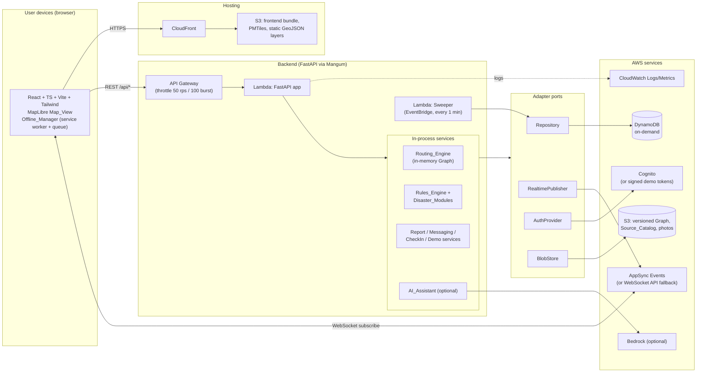
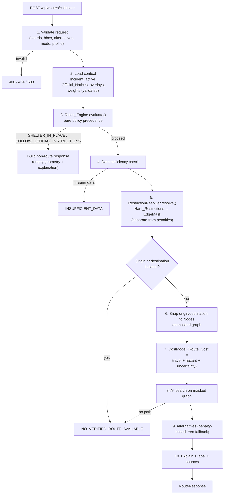
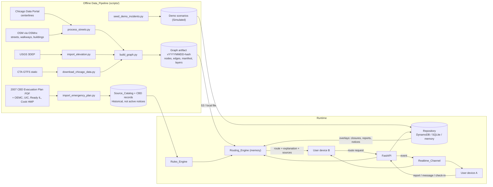
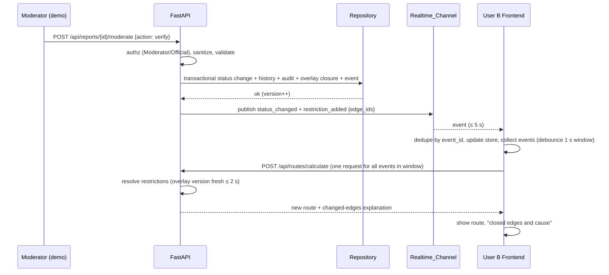
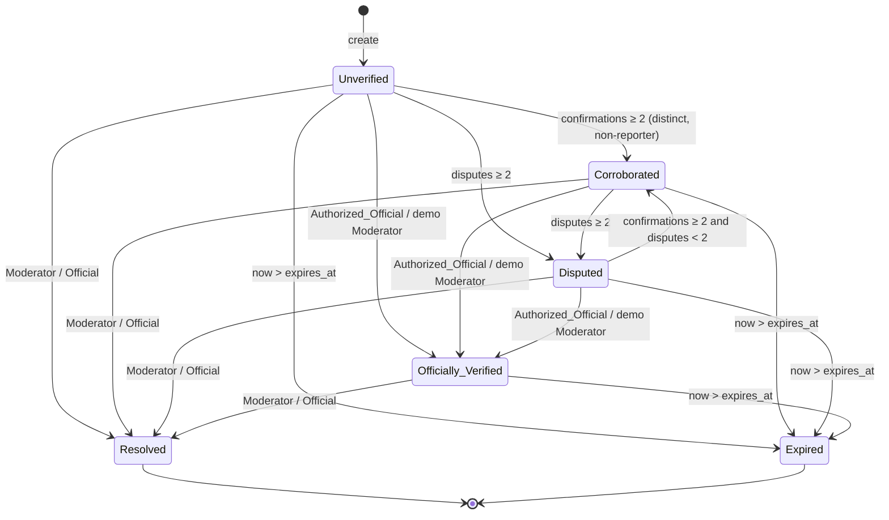
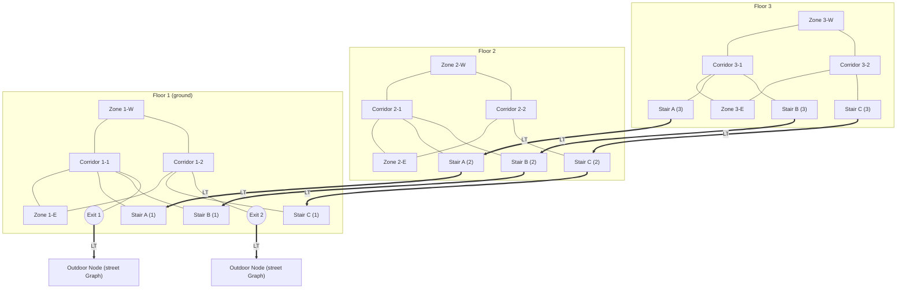

# Design Document: SafePath Evacuation Navigation

## Overview

SafePath is a disaster-aware evacuation navigation and real-time community communication prototype for downtown Chicago, built in 24 hours for HackOHI/O 2026. It is a research and demonstration prototype, not an approved life-safety or dispatch system. Every rule, zone, closure, shelter and destination carries a Source_Record and a Data_Classification, and every demo incident is simulated.

### Design goals (in priority order)

1. A real Chicago street network (OSMnx + Chicago Data Portal + USGS 3DEP) stored as a versioned static artifact and loaded into memory by the routing service.
2. Disaster-adjusted routing: hard-restriction filtering as a step separate from penalty costing, k alternatives, per-disaster policy modules, and a rules engine with explicit Policy_Outcome precedence.
3. Cloud-backed reports (DynamoDB behind a repository adapter).
4. Real-time updates between users (AppSync Events, WebSocket fallback, local in-process mode).
5. A polished, rehearsable demo (three SIMULATED scenarios, Demo_Admin_Console, reset in under 30 seconds).

### Key design decisions

| # | Decision | Rationale |
|---|----------|-----------|
| D1 | The Graph is a static, versioned artifact (`graphs/{version}/…` in S3, or `data/processed/` locally). The routing service loads it into memory at cold start. Edges are never read per-request from DynamoDB. | Downtown Chicago is roughly 20k–60k edges, which fits in memory. A per-edge DynamoDB lookup would add latency and cost for no benefit (Req 30.7, 32). |
| D2 | Dynamic state (closures, hazard polygons, reports, notices) lives in a separate **overlay** store and is applied to the in-memory Graph at request time as a `RestrictionSet` plus a `PenaltyContext`. | Keeps the Graph immutable and cacheable. Closure changes take effect without rebuilding anything (Req 14.7, 16.3, 30.7). |
| D3 | Routing is a pipeline: **policy gate → restriction resolution (hard) → penalty cost model (soft) → A\* search → alternatives → explanation**. Hard restrictions produce an edge mask before search starts. Penalties only enter the cost function. | Directly satisfies Req 14.1 and 14.2, and makes "no route crosses a hard restriction" a testable invariant. |
| D4 | All external side effects go through four **adapter ports**: `Repository`, `RealtimePublisher`, `AuthProvider`, `BlobStore`. Each has a local implementation and an AWS implementation, selected by `SAFEPATH_PROFILE=local\|aws` and per-port overrides. | The AWS sandbox permissions are unknown until inspected (Req 29.1, 29.5). The same code and tests run in-memory, on SQLite or DynamoDB Local, and on AWS (Req 29.7). |
| D5 | The Penalty weight file (`routing_weights.yaml`) is validated at startup and on every reload. An invalid file puts the routing endpoint in a 503 state. | Req 13.2 and 13.12. |
| D6 | Policy precedence is implemented in a single pure function in the Rules_Engine. | A pure function over (incident, notices, origin, now) is easy to test with Hypothesis (Req 11, 19, 44.6). |
| D7 | Guests use backend-issued signed demo tokens (HS256, 24h expiry). Registered users, Moderators and Authorized_Officials use Cognito when it is permitted. The `AuthProvider` port makes the substitute swappable. | Cognito may be blocked in the sandbox. Role assignment never comes from client claims alone (Req 22, 31.4). |
| D8 | The tile source is a self-hosted **PMTiles** extract of the Chicago bounding box in S3/CloudFront (local file in dev). Zoom 12–16 is precached by the service worker. | The OSM tile-usage policy forbids bulk prefetching from tile.openstreetmap.org. A PMTiles extract of our own box makes offline caching legitimate and fast (Req 41.1, 3.8). |
| D9 | Hazard polygons and static layers (buildings, stations, boundaries, elevation classes) are published as static GeoJSON next to the Graph version and served by CloudFront. Dynamic overlays come through the API and Realtime_Channel. | Fewer Lambda invocations and simple offline caching. |

### Research summary

Items below informed the design. Links are to official documentation.

- **OSMnx** builds drivable and walkable `MultiDiGraph`s from OSM, including `oneway`, `bridge`, `tunnel`, `layer` and `highway` tags, and can add elevation. It is the offline graph builder; its output is converted to SafePath's own compact schema so the Lambda package does not need OSMnx, GeoPandas or GDAL ([OSMnx docs](https://osmnx.readthedocs.io/)).
- **USGS 3DEP** elevation (NAVD 88) is accessible through the 3DEP ImageServer/TNM or the `py3dep` client. It is sampled once offline per Node ([USGS 3DEP](https://www.usgs.gov/3d-elevation-program)). Bare-earth terrain does not describe bridge decks or tunnels, so bridge, tunnel and lower-level edges get Low or Unknown `elevation_confidence` (Req 4.4, 4.6).
- **Chicago Data Portal** street centerlines (`6imu-meau`) are available through the Socrata SODA API / GeoJSON export ([dataset](https://data.cityofchicago.org/d/6imu-meau)).
- **AWS AppSync Events** offers serverless pub/sub over WebSockets with channel namespaces and HTTP publish. Publish uses a signed HTTP POST, and subscribers connect with a WebSocket subprotocol and an auth header ([AppSync Events](https://docs.aws.amazon.com/appsync/latest/eventapi/event-api-welcome.html)). It is new, so availability in the sandbox must be checked. The fallback is an API Gateway WebSocket API with a DynamoDB connections table.
- **Mangum** adapts an ASGI app (FastAPI) to Lambda + API Gateway/HTTP API ([Mangum](https://mangum.fastapiexpert.com/)). The same `app` object runs under `uvicorn` locally.
- **MapLibre GL JS** supports GeoJSON sources, data-driven styling and the PMTiles protocol via the `pmtiles` JS package ([MapLibre](https://maplibre.org/maplibre-gl-js/docs/)).
- **Hypothesis** (Python) and **fast-check** (TypeScript) are the property-based testing libraries ([Hypothesis](https://hypothesis.readthedocs.io/), [fast-check](https://fast-check.dev/)).
- **Alternatives:** k-shortest-path via Yen's algorithm is exact but costs k × (path length) searches. A **penalty-based** method (inflate the cost of edges already used, re-search, deduplicate) is simpler and produces more visually distinct routes. The design uses penalty-based alternatives first, with a Yen's-style spur fallback when too few distinct routes result.

(Content in this section was rephrased from public documentation for compliance with licensing restrictions.)

## Architecture

### System context and deployment



### Local development profile

When AWS is unavailable the same FastAPI app runs under `uvicorn`, and each port binds to a local implementation.

| Port | AWS implementation | Local implementation |
|------|--------------------|----------------------|
| `Repository` | `DynamoRepository` (boto3) | `MemoryRepository` (default, used by tests and demo) or `SqliteRepository`. `DynamoRepository` also works against DynamoDB Local via `AWS_ENDPOINT_URL`. |
| `RealtimePublisher` | `AppSyncEventsPublisher`, or `ApiGwWebSocketPublisher` (fallback) | `InProcessPublisher` with a FastAPI WebSocket endpoint `/ws/incidents/{id}` and an SSE endpoint `/sse/incidents/{id}` |
| `AuthProvider` | `CognitoAuthProvider` (JWT verification against the JWKS endpoint) | `DemoTokenAuthProvider` (HMAC-signed tokens, roles from a local `roles.yaml` admin config) |
| `BlobStore` | `S3BlobStore` (presigned URLs, 15 min) | `LocalBlobStore` (filesystem, signed local URLs with expiry) |
| Graph source | `s3://…/graphs/{version}/` | `data/processed/graphs/{version}/` |

The substitution matrix is recorded in `docs/aws-deployment.md` and `docs/safety-limitations.md`, and the active profile is reported by `GET /api/health`.

### Routing request pipeline



### Data flow



### Sequence: closure verified, active route recalculated



### Hazard report verification state machine



Corroboration can never produce `Officially_Verified`. The only transition into it is an explicit moderate action by an authorized actor.

### Indoor graph (fictional building)



`==LT==>` marks an explicit Level_Transition Edge (`edge_kind = "level_transition"`, bidirectional pair, each with a `transition_type`: `stairwell`, `exit`, `platform_stair`, `ramp`). Every floor change, every exit-to-outdoor link and every station street-to-platform link is one of these edges. A Stairwell closure removes that stairwell's Level_Transition edges (and its corridor links) from the mask.

## Components and Interfaces

### Repository layout

```
safepath/
  frontend/src/{components,pages,hooks,services,maps,styles}
  backend/app/{api,models,services,routing,disasters,communication,auth}
  backend/app/adapters/{repository,realtime,blob}      # port + implementations (deviation noted in README)
  data/{raw,processed,demo,sources}
  scripts/                                              # Data_Pipeline entry points
  infrastructure/aws/                                   # CDK (TypeScript)
  tests/{backend,frontend,e2e,pipeline}
  docs/
```

`backend/app/adapters/` and `tests/` subfolders are additions to the layout in Requirement 45.1 and are documented in the README. Auth adapters live in `backend/app/auth/`.

### Backend modules

| Module | Responsibility | Key public interface |
|--------|----------------|----------------------|
| `api/` | FastAPI routers, dependency injection, error envelope, rate limiting, authz decorators, OpenAPI | `create_app(settings) -> FastAPI`, `handler = Mangum(app)` |
| `models/` | Pydantic v2 models (domain, request, response), public/private serializers | see Data Models |
| `routing/graph.py` | `Graph` loader/validator, adjacency arrays, spatial index (shapely STRtree, built lazily), snap-to-node | `Graph.load(source) -> Graph`, `graph.snap(lat, lon, mask)` |
| `routing/restrictions.py` | `RestrictionResolver` (hard) | `resolve(ctx) -> RestrictionSet` |
| `routing/cost.py` | `CostModel`, `PenaltyComponents`, weights loader/validator | `edge_cost(edge, ctx) -> (cost, components)` |
| `routing/search.py` | A\* / Dijkstra over a masked graph | `search(graph, mask, src, dst, cost_fn) -> Path \| None` |
| `routing/alternatives.py` | Penalty-based k-alternatives and Yen spur fallback | `k_routes(…) -> list[Path]` |
| `routing/explain.py` | Route explanation, reason summary, uncertainty level | `explain(paths, ctx) -> list[RouteExplanation]` |
| `routing/service.py` | Orchestrates the pipeline | `RoutingService.calculate(req, principal) -> RouteResponse` |
| `disasters/base.py` | `DisasterModule` protocol and registry | below |
| `disasters/{flood,earthquake,tornado,fire,building}.py` | Policy modules | one class each |
| `disasters/rules_engine.py` | Official_Notice evaluation and Policy_Outcome precedence | `evaluate(ctx) -> PolicyDecision` |
| `services/reports.py` | Report lifecycle, dedupe, edge association, verification state machine | `ReportService` |
| `services/sources.py` | Source_Catalog search, labeling | `SourceCatalog` |
| `services/demo.py` | Scenario start, advance, reset | `DemoService` |
| `services/sweeper.py` | Expiry transitions and location scrub | `run_sweep(now)` |
| `services/ai.py` | Bedrock client plus output guard | `AIAssistant.summarize(ctx)` |
| `communication/` | Messaging, check-ins, event envelope, publish-after-commit | `MessagingService`, `CheckInService`, `EventBus` |
| `auth/` | `AuthProvider` port, Cognito and demo-token implementations, role matrix, audit | `Principal`, `require(role, …)` |

### Adapter ports

```python
class Repository(Protocol):
    def put(self, table: str, item: dict, *, if_absent: bool = False) -> None: ...      # raises Conflict
    def get(self, table: str, key: dict) -> dict | None: ...
    def query(self, table: str, key_cond: dict, *, index: str | None = None,
              since: str | None = None, limit: int = 100) -> list[dict]: ...
    def update_cas(self, table: str, key: dict, expected_version: int, patch: dict) -> dict: ...  # raises Conflict
    def transact(self, ops: list[TxOp]) -> None: ...        # all-or-nothing; raises RepositoryUnavailable
    def delete_where(self, table: str, predicate: Mapping) -> int: ...                  # scenario reset

class RealtimePublisher(Protocol):
    def publish(self, incident_id: str, event: Event) -> None: ...   # best-effort; never raises to caller

class AuthProvider(Protocol):
    def verify(self, token: str | None) -> Principal: ...            # raises Unauthenticated
    def issue_guest(self) -> GuestSession: ...                       # 24 h expiry
    def role_for(self, subject: str) -> Role: ...                    # from admin config / Cognito group

class BlobStore(Protocol):
    def presign_put(self, key: str, content_type: str, max_bytes: int) -> PresignedUpload: ...
    def presign_get(self, key: str, ttl_seconds: int = 900) -> str: ...
```

Write order for any state change: `Repository.transact(...)` first (record, history, audit, overlay, and the `Event` row). Only after it commits does the `EventBus` call `RealtimePublisher.publish`. A repository failure raises `RepositoryUnavailable`, which maps to HTTP 503 with nothing persisted and nothing published (Req 30.9). A publish failure is logged and never fails the request. Clients recover via the catch-up endpoint (Req 25.6).

### Disaster module interface

```python
@dataclass(frozen=True)
class IncidentContext:
    incident: Incident
    now: datetime
    notices: list[OfficialNotice]       # active, eligible, non-CBD, with Source_Record
    reports: list[HazardReport]         # non-Resolved, non-Expired
    overlays: list[Restriction]         # confirmed closures, impassable polygons
    origin: LatLon; destination: LatLon | None
    profile: MobilityProfile; mode: TravelMode

class DisasterModule(Protocol):
    incident_type: IncidentType
    def policy_override(self, ctx) -> PolicyOverride | None: ...          # e.g., tornado SHELTER_IN_PLACE
    def hard_restrictions(self, ctx, graph) -> Iterable[Restriction]: ...  # edge ids + cause + source ids
    def edge_penalty(self, edge: Edge, ctx, graph) -> PenaltyParts: ...    # hazard + uncertainty parts, both ≥ 0
    def route_filter(self, edge: Edge, ctx) -> bool: ...                   # tornado: exclude outdoor edges
    def uncertainty_floor(self, ctx) -> UncertaintyLevel | None: ...       # flood with no evidence → High
    def advisories(self, ctx) -> list[Advisory]: ...                       # text + Source_Record
```

`hard_restrictions` and `edge_penalty` are called from different pipeline stages (5 and 7). Modules cannot move an edge from one category to the other, which guards Req 14.2. Module-specific behavior:

| Module | Hard restrictions (Req) | Penalties (Req) | Other |
|--------|-------------------------|-----------------|-------|
| Flood | Edges intersecting confirmed closures, modeled impassable flood polygons, officially reported flooded segments (17.1, 17.5) | Tunnel/underpass and lower-level penalties; extra penalty for lower-level edges within 50 m of the river or lake shoreline; elevation penalty non-increasing in mean elevation; uncertainty penalty for Low/Unknown `elevation_confidence` (17.2–17.4) | No evidence → only infra and elevation penalties and `uncertainty_floor = High` (17.8). Wording is "lower modeled exposure", never "flood-safe" (17.7). |
| Earthquake | Edges intersecting confirmed bridge closures, collapse exclusion zones, debris zones, or notice-identified segments (18.1, 18.2) | High-rise proximity penalty only for edges within 50 m of a building tied to an active debris zone, notice or report. `Building_Height_Class` alone never adds a penalty. Confirmed official structural info replaces heuristics (18.3–18.5) | Debris polygons from demos are labeled Simulated. |
| Tornado | none | none | `policy_override` returns `SHELTER_IN_PLACE` when the origin is inside the Incident boundary and the warning is active. It includes the official shelter and Source_Record when one exists, or "no verified shelter available" plus guidance otherwise. `route_filter` excludes outdoor edges. After the status leaves active, outdoor routing resumes (19.1–19.7). |
| Fire | Edges intersecting a verified perimeter or official prohibited area, and confirmed blocked streets. An unverified perimeter without an Official_Source is a Penalty plus warning only (20.1, 20.2, 20.6) | Penalty for edges within 100 m of an Unverified/Corroborated/Disputed fire or smoke report (20.3) | Official fire instruction displayed and applied ahead of computed routes through the Rules_Engine (20.4). |
| Building | Indoor edges of stairwells whose closure is confirmed by a demo Moderator or an Authorized_Official (21.4) | Reported-blocked stairwells (unconfirmed) carry a penalty. Exits and stairwells are never described as safe (21.5). | Operates on the Indoor_Graph. All stairwells to an exit removed gives `NO_VERIFIED_ROUTE_AVAILABLE` (21.7). |

### Rules_Engine and Policy_Outcome precedence

`evaluate(ctx) -> PolicyDecision` is pure and deterministic. It first filters records to the eligible set, then applies the precedence list in order. The first matching rule wins.

Eligibility filter, applied to every rule, zone, closure, shelter, destination and notice:

1. A record without a Source_Record is excluded and labeled "Unknown source" (10.8).
2. A record derived from the CBD_Plan is excluded from evaluation as an active notice (8.9). It remains available as a Historical reference.
3. A Cook County Hazard Mitigation Plan area is excluded as a live Incident boundary (9.5).
4. A notice is excluded when `now > expires_at + 60 s` (11.9).
5. A notice is excluded when `effective_at > now`.

Precedence, highest first:

| Rank | Condition | Policy_Outcome | Requirement |
|------|-----------|----------------|-------------|
| 1 | Two or more active notices give conflicting instructions for an area containing the origin | `FOLLOW_OFFICIAL_INSTRUCTIONS` with every notice's text and Source_Record | 11.8 |
| 2 | An active shelter-in-place notice covers the origin | `SHELTER_IN_PLACE` | 11.4 |
| 3 | An active notice requires following instructions SafePath cannot model (including fire instructions) | `FOLLOW_OFFICIAL_INSTRUCTIONS` | 11.6, 20.4 |
| 4 | Module `policy_override` (tornado active and origin inside boundary) | `SHELTER_IN_PLACE` (official notice text first, if any) | 19.1, 19.6 |
| 5 | Required data missing (graph not loaded, no snap candidate, missing elevation data when the module requires it, and similar) | `INSUFFICIENT_DATA` with the list of missing items | 13.7 |
| 6 | Hard restrictions isolate origin and/or destination, or no path exists | `NO_VERIFIED_ROUTE_AVAILABLE` | 13.6, 14.8 |
| 7 | Otherwise | `ROUTE_OPTIONS_AVAILABLE` | |

Destination ranking: when an active notice designates an incident-specific destination, it is ranked ahead of every non-official destination (11.5). Road-direction restrictions from notices become directed Edge constraints in the mask (11.7).

### RestrictionResolver (hard step)

```python
@dataclass(frozen=True)
class RestrictionSet:
    blocked_edges: Mapping[str, tuple[RestrictionCause, ...]]   # edge_id -> causes (kind, id, source_record_id, simulated)
    overlay_version: int
    def mask(self, graph) -> EdgeMask                           # numpy bool array aligned with graph.edges

class RestrictionResolver:
    def resolve(self, ctx, graph, modules) -> RestrictionSet: ...
```

Inputs: confirmed closures (`Officially_Verified` reports, demo Moderator-confirmed closures), official prohibited areas, modeled impassable polygons, notice road-direction restrictions, and module `hard_restrictions`. Geometry rule: an edge is blocked when its LineString `intersects` the polygon (shares at least one point, Req 14.4). The STRtree gives candidates and shapely does the exact test. Results are cached by `(overlay_version, incident_id, graph_version)`.

Reports with status Unverified, Corroborated or Disputed are never passed to the resolver. They only reach the CostModel as soft context (14.5).

Freshness: the overlay version is a counter stored in the Repository and incremented in the same transaction as any restriction change. Each route request reads it (a single `get`, with an in-process TTL of at most 2 s). This keeps added and removed restrictions effective well inside the 5 s requirement (14.7, 16.3, 21.4).

### CostModel (soft step)

```
Route_Cost(e) = travel_cost(e) + disaster_hazard_penalty(e) + uncertainty_penalty(e)
```

All terms are expressed in seconds-equivalent and are non-negative.

- `travel_cost(e) = e.estimated_travel_time_seconds × mode_factor(mode, profile)`. `mode_factor ≥ 1` for slower profiles and is read from the weights file.
- Penalties are scaled by edge length so a long edge is never cheaper to cross than a short edge: `scale(e) = max(e.distance_meters, d_min) / 100`.
- `uncertainty_penalty(e) = scale(e) × (w_unknown_attr × n_unknown(e) + w_elev_low × [conf = Low] + w_elev_unknown × [conf = Unknown] + w_profile_unknown × [profile needs step-free ∧ mobility_accessibility = Unknown] + w_disputed × disputed_report_hits(e))`. `n_unknown(e)` counts Unknown values among the configured `uncertainty_attributes`. Every Unknown contributes a strictly positive amount (`w_unknown_attr > 0` is enforced by config validation), covering 12.4, 13.8, 17.4 and 44.7.
- `disaster_hazard_penalty(e)` is the sum of the active module's parts plus report-derived warnings. For flood:
  - `w_tunnel × [tunnel_flag ∨ underpass]`
  - `w_lower × [infrastructure_level = lower-level]`
  - `w_shore × [lower-level ∧ dist_to_water ≤ 50 m]`
  - `w_elev × clamp((E_high − ē(e)) / (E_high − E_low), 0, 1)`, where `ē` is the mean of `elevation_start` and `elevation_end`. This is non-increasing in `ē` (17.3) and is applied only when both elevations are known; otherwise the uncertainty term applies.
- `PenaltyComponents` (travel, per-named hazard part, per-named uncertainty part, report ids) are recorded per edge on the returned route (13.5).

A\* heuristic: `h(n) = haversine(n, dst) / v_max(mode)`. Because `Route_Cost(e) ≥ travel_cost(e) ≥ distance(e)/v_max`, the heuristic is admissible and consistent, so A\* returns the same optimal cost as Dijkstra. Dijkstra is the reference implementation in tests (model-based testing).

Weights file `backend/app/routing/routing_weights.yaml`:

```yaml
version: 1
mode_factor: { walking: 1.0, wheelchair: 1.4, driving: 1.0 }
v_max_mps:   { walking: 2.0, wheelchair: 1.5, driving: 20.0 }
d_min_meters: 10
uncertainty_attributes: [infrastructure_level, pedestrian_access, bridge_flag, tunnel_flag, elevation_confidence]
uncertainty: { w_unknown_attr: 8, w_elev_low: 6, w_elev_unknown: 12, w_profile_unknown: 15, w_disputed: 10 }
flood:      { w_tunnel: 120, w_lower: 80, w_shore: 60, w_elev: 40, E_low: 176.0, E_high: 184.0 }
earthquake: { w_highrise_proximity: 60, proximity_meters: 50 }
fire:       { w_smoke_report: 90, radius_meters: 100 }
building:   { w_reported_blocked_stair: 100 }
alternatives: { inflate_factor: 1.5, max_attempts: 8, min_distinct_edges: 1 }
uncertainty_levels: { medium_fraction: 0.05, high_fraction: 0.20 }
```

(E_low/E_high are placeholder elevation bounds in meters, recomputed at pipeline time from the Graph's elevation percentiles and written to the manifest.)

### Alternatives

1. Compute the optimal path P1.
2. For i = 2..k, multiply the cost of every edge in the previously accepted paths by `inflate_factor` (only inside the search, not in the reported cost) and search again.
3. Accept the result only if it differs from every accepted path by at least one edge. After `max_attempts` without a new route, fall back to a Yen-style spur pass on P1 and take the cheapest distinct spur path.
4. Report true (uninflated) Route_Cost, distance and duration for each. Return up to k routes and the count actually returned (13.4).

Hard restrictions are in the mask for all passes, so no alternative can cross a restricted edge.

### Uncertainty level

`Uncertainty_Level` for a route is derived from the fraction `f` of route length on edges with at least one Unknown or Low-confidence attribute: `Low` if `f < 0.05`, `Medium` if `f < 0.20`, `High` otherwise, and `Unknown` when the route has no attribute coverage at all. Module `uncertainty_floor` can only raise the level (for example, flood with no evidence gives High).

### Route explanation

`RouteExplanation` contains: restrictions considered (kind, id, source), count of excluded edges, per-edge penalty components, a human reason summary relative to the other returned routes (differences in distance, duration and each cost component), the data timestamp of the latest applied update, the sources list (Source_Record ids of every notice, restriction and report that affected the route), and the label `algorithm-generated`. Flood wording is limited to "lower modeled exposure". For demo debris zones, each excluded edge links to its Simulated zone id (38.4).

### Frontend structure

```
frontend/src/
  components/  Header, DisclaimerBanner, SimulatedBadge, SourceLabel, LeftSidebar, RightSidebar,
               BottomControls, RoutePanel, ReportForm, MessageList, CheckInForm, Emergency911Panel,
               StatusBadge (text + icon + color), LayerToggles, OfflineBanner, AdminConsole
  pages/       MainMap, DisasterSelect, RouteDetails, SubmitReport, Community, IncidentOverview,
               CheckIn, SourcesLimitations, DemoAdmin
  hooks/       useRealtime, useRouteRecalc, useOfflineQueue, useAuth, useIncident
  services/    api.ts (typed client from OpenAPI), realtime/{AppSyncEventsClient,WebSocketClient,SseClient}.ts,
               eventStore.ts (reducer), offlineQueue.ts, backoff.ts, labels.ts
  maps/        MapView.tsx, layers/*.ts, pmtiles.ts, inspect.ts
  styles/      tailwind.css, tokens.ts (palette, contrast-checked)
```

Principles:

- A single `eventStore` reducer applies Realtime events. It is idempotent and tracks `appliedEventIds` and `lastEventId`. This yields dedupe (25.8) and catch-up (25.6).
- `RealtimeClient` is an interface. The implementation is chosen from `VITE_REALTIME_MODE=appsync|websocket|sse`.
- `DisclaimerBanner` is rendered by the root layout. It has no dismiss control and is not conditionally hidden (1.1).
- `labels.ts` exposes `classify(item) -> "Official" | "Simulated" | "Community" | "Unknown source"` and is used by every list and popup (10.4, 10.5, 36.5).
- `useRouteRecalc` batches restriction events for the active route within a 1 s window into one request, and fires within the 5 s limit (16.4, 16.7).
- `Offline_Manager` uses Workbox: precache app shell, runtime-cache PMTiles range requests and static GeoJSON, and store the report queue in IndexedDB (max 50, FIFO submit, client UUID idempotency key).
- Map layers are toggled by changing layout `visibility`, which is immediate (34.3).
- Status chips always include an icon plus a text label, never color alone (36.2). Palette tokens are tested for contrast ≥ 4.5:1 (36.3).

### API contracts

All paths are under `/api`. Errors use the envelope below. Auth: `Bearer` token (guest demo token or Cognito JWT).

```json
{ "error": { "code": "validation_error", "message": "…",
             "fields": [ { "field": "origin.latitude", "problem": "out of range" } ],
             "retry_after_seconds": null } }
```

| Method & path | Auth / role | Success | Errors |
|---------------|-------------|---------|--------|
| GET `/health` | none | 200 `{status, graph_version, profile, time}` (≤ 1 s) | |
| GET `/regions` | none | 200 list | |
| GET `/regions/chicago/metadata` | none | 200 `{bounds{n,s,w,e}, neighborhoods[], crs{pipeline:"EPSG:26916", api:"EPSG:4326"}, graph_version}` | |
| GET `/graph/status` | none | 200 `{version, built_at, node_count, edge_count, active_closure_count}` | |
| GET `/incidents`, GET `/incidents/{id}` | none | 200 | 404 |
| POST `/incidents` | Moderator or Official | 201 | 401, 403, 400 |
| POST `/routes/calculate` | Guest+ | 200 | 400, 404, 413, 429, 503 |
| POST `/reports` | Guest+ | 201 (idempotent on `client_report_id`) | 400, 401, 413, 415, 429, 503 |
| GET `/reports?incident_id&since&status` | none | 200 | 400 |
| POST `/reports/{id}/corroborate`, `/dispute` | Guest+ | 200 | 401, 403 (own report), 404, 409, 429 |
| POST `/reports/{id}/moderate` | Moderator or Official | 200 | 401, 403, 404, 409, 400 |
| GET `/messages?incident_id&since`, POST `/messages` | read: none; write: Guest+ | 200/201 | 400, 401, 404, 429 |
| POST `/messages/{id}/hide` | Moderator or Official | 200 | 401, 403, 404 |
| POST `/checkins`, GET `/checkins?incident_id` | write: Guest+; read: filtered by visibility | 200/201 | 400, 401, 404, 429 |
| GET `/sources?q&classification&verification_status` | none | 200 (≤ 2 s) | 400 listing permitted values |

Additive endpoints, required by other requirements but not in the Req 42.1 list. All are documented in OpenAPI:

| Method & path | Purpose | Requirement |
|---------------|---------|-------------|
| POST `/auth/guest` | Issue a 24 h guest demo token | 22.1 |
| GET `/events?incident_id&since=<event_id>` | Catch-up after reconnect and polling fallback (≥ 30 s interval) | 25.6, 25.7 |
| POST `/notices` | Create an Official_Notice (Authorized_Official only, audited) | 28.8, 11.2 |
| POST `/photos/presign` | Presigned photo upload (when enabled) | 23.5, 23.9 |
| POST `/demo/{scenario}/start\|advance\|reset`, POST/DELETE `/demo/closures` | Demo_Admin_Console (Moderator only) | 40 |
| POST `/ai/summarize` | Optional AI summaries | 33 |
| GET `/transit/alerts` | CTA alerts (if credentials configured) | 5.2–5.4 |

Route request and response:

```json
// POST /api/routes/calculate
{ "incident_id": "inc_flood_loop_01",
  "origin": { "latitude": 41.8883, "longitude": -87.6324 },
  "destination": { "latitude": 41.8827, "longitude": -87.6233 },
  "travel_mode": "walking", "mobility_profile": "standard", "alternatives": 3,
  "origin_indoor_node_id": null }   // optional extension for Building incidents
```

```json
{ "policy_outcome": "ROUTE_OPTIONS_AVAILABLE", "explanation": "…", "status": "ok",
  "calculated_at": "2026-01-01T12:00:00Z", "graph_version": "v20260101-ab12cd",
  "data_timestamp": "2026-01-01T11:59:58Z", "route_count": 2,
  "label": "algorithm-generated",
  "routes": [ {
    "route_id": "rt_…", "route_type": "disaster-adjusted",
    "geometry": { "type": "LineString", "coordinates": [[-87.63,41.88]] },
    "distance_meters": 1432.5, "estimated_duration_seconds": 1120,
    "hazard_flags": ["lower_level_avoided"], "excluded_edges_count": 41,
    "uncertainty_level": "Medium",
    "restrictions_considered": [ { "kind": "closure", "id": "rst_…", "source_record_id": "src_…", "simulated": true } ],
    "edge_penalties": [ { "edge_id": "e123", "travel": 31.2, "hazard": {"lower_level": 80}, "uncertainty": {"unknown_attr": 8} } ],
    "reason_summary": "+120 m, −35 s travel, +90 s hazard avoided vs. route 1",
    "sources": ["src_…"], "confidence_limitations": ["Elevation Low confidence on 12% of length"] } ] }
```

When `policy_outcome ≠ ROUTE_OPTIONS_AVAILABLE`, `routes` is empty (or each route has empty geometry), and `explanation`, `notices` (text plus Source_Record) and `missing_data` are populated (15.5, 43.4).

Realtime event envelope (all event types):

```json
{ "event_id": "01J…ULID", "incident_id": "…", "type": "report_created|report_status_changed|restriction_added|restriction_removed|message_created|message_hidden|checkin_created|notice_created|incident_updated|scenario_reset",
  "created_at": "…", "payload": { } }
```

`event_id` is a ULID, so lexicographic order matches creation order. The channel is `/safepath/incident/{incident_id}` on AppSync Events, or `/ws/incidents/{incident_id}` in the WebSocket and local modes.

### Security and authorization

- One `require(role_set)` FastAPI dependency per route. Role comes from the verified token plus the admin-config or Cognito-group mapping, never from a client-supplied body field.
- Self-role escalation requests return 403 and an audit entry (22.4).
- Serializers: every record has `PublicView` and `PrivateView` Pydantic models. Routers return only `PublicView` unless `principal.user_id == record.owner_id`. The reporter alias is `HMAC(server_secret, user_id, incident_id)` mapped to a word-pair alias, so it contains no part of the display name, email or id (22.5).
- Input safety: Pydantic validation, `nh3` HTML stripping on all free text before storage, a 1 MB request body cap middleware (413), and rate limiting through a `RateLimiter` port (DynamoDB atomic counters with TTL; in-memory locally) returning 429 with `Retry-After`.
- Secrets come from environment variables / SSM Parameter Store / Secrets Manager. The frontend bundle has only public identifiers (API base URL, Cognito client id, AppSync endpoint). CORS is restricted to the CloudFront origin.
- IAM: one Lambda role per function (API, Sweeper) with resource-scoped policies (specific table ARNs, bucket prefixes, Bedrock model ARN).
- TLS ≥ 1.2 at CloudFront and API Gateway; DynamoDB and S3 are encrypted at rest (SSE). S3 public access is blocked.
- Locations: exact positions are returned only to the owner. Check-in coordinates are rounded to a grid ≥ 200 m before storage when shared. Disabling sharing triggers an event that removes the location from public views within 5 s (31.9).

### Infrastructure (CDK, TypeScript)

| Stack | Resources |
|-------|-----------|
| `DataStack` | DynamoDB tables (on-demand, PITR off, SSE, TTL on events, rate limits, sessions); S3 `graphs/` bucket (versioned, private); photos bucket (private, lifecycle). |
| `ApiStack` | Lambda (Python 3.12, 1024–1769 MB, Graph loaded to memory from S3 at cold start); API Gateway HTTP API with throttling 50 rps / burst 100; Sweeper Lambda + EventBridge rule (1 min); Cognito user pool, client and groups; AppSync Events API (or WebSocket API + connections table); optional Bedrock invoke permission. |
| `WebStack` | S3 website bucket, CloudFront distribution (OAC), PMTiles and GeoJSON as static objects. |
| `ObservabilityStack` | CloudWatch log groups (7-day retention), basic alarms, metrics for route latency. |
| `BudgetStack` (optional) | AWS Budgets monthly 25 USD, alert at 80%, created only when permitted. |

Cross-cutting: a CDK Aspect tags every resource `Project=SafePath`. Optional components are controlled by CDK context flags written from the discovery step: `-c useCognito=false -c realtime=appsync|apigw-ws -c enableBudget=false -c enableBedrock=false -c enableCloudFront=false`. Removal policy is `DESTROY` only for tagged demo resources. CloudFormation rollback on failure removes the resources created by that deployment and never touches untagged resources (29.8). The step-zero script `scripts/aws_discovery.py` runs `sts get-caller-identity`, `iam simulate-principal-policy` (or probe calls) and quota queries, then writes findings to `docs/aws-deployment.md` before `cdk deploy` is allowed (29.1).

### Data_Pipeline

| Script | Output |
|--------|--------|
| `download_chicago_data.py` | `data/raw/*` (git-ignored) with retry (3 attempts, 60 s timeout), previous-copy fallback and per-dataset status |
| `process_streets.py` | Merges Chicago centerlines with OSM (`precedence: CDP geometry & name, OSM for access/bridge/tunnel/layer` documented), unknown handling (`"Unknown"` literal, never defaulted), conflict warnings |
| `import_elevation.py` | Samples 3DEP at Nodes (meters, NAVD 88), sets `elevation_confidence`, counts Unknown |
| `build_graph.py` | Builds Nodes/Edges, drops edges with missing endpoints (warning with `edge_id`), adds Level_Transition edges (stations, demo building), writes versioned artifact and `summary_report.json` |
| `import_emergency_plan.py` | Downloads CBD_Plan, extracts structured records with page and section, approximate CBD boundary, search records for missing appendices and newer versions, Source_Catalog entries for OEMC, UIC, Ready Illinois and Cook HMP |
| `seed_demo_incidents.py` | Creates demo Incidents (all `simulation_flag = true`), polygons, designated simulation destination, fictional Indoor_Graph, seeded users |

Stage order is a fixed list: `check_availability → save_raw → reproject(EPSG:26916) → clip(bbox) → clean_geometry → normalize → build_nodes_edges → save_outputs`. A failed stage excludes that dataset's partial outputs and continues. The run fails only if neither street source exists in any form, and in that case the previously saved Graph is untouched. Versions are `v{UTC date}-{short content hash}` and are written to a new directory and never overwritten. `graphs/latest.json` is updated last and atomically.

Artifact layout:

```
graphs/v20260315-3fa9c1/
  manifest.json      # version, built_at, sha256 per file, counts, crs, elevation percentiles, source_record_ids
  nodes.jsonl.gz     # {node_id, lat, lon, elevation_m, elevation_conf, kind, level}
  edges.jsonl.gz     # one Edge per line (schema below), geometry as encoded polyline
  layers/{buildings,stations,boundary,tiers}.geojson
  summary_report.json
```

## Data Models

### Graph models

```python
class Node(BaseModel):
    node_id: str; lat: float; lon: float
    kind: Literal["intersection","building_entrance","pedestrian_junction","indoor"]
    level: str = "surface"                       # or "floor:2", "platform", "lower-level" …
    elevation_m: float | Literal["Unknown"]
    building_id: str | None = None               # indoor nodes

class Edge(BaseModel):
    edge_id: str; from_node: str; to_node: str
    geometry: str                                # encoded polyline (precision 6)
    distance_meters: PositiveFloat
    estimated_travel_time_seconds: PositiveFloat
    travel_mode: list[Literal["walking","wheelchair","driving"]]   # one-way streets: driving only in direction of travel
    source: str; source_ids: dict[str, str]
    road_type: str | Unknown
    elevation_start: float | Unknown; elevation_end: float | Unknown
    elevation_confidence: Literal["High","Medium","Low","Unknown"]
    bridge_flag: bool | Unknown; tunnel_flag: bool | Unknown
    infrastructure_level: Literal["surface","lower-level","elevated","bridge","tunnel","Unknown"]
    pedestrian_access: bool | Unknown
    mobility_accessibility: Literal["accessible","inaccessible","Unknown"]
    current_closure_status: Literal["open","closed","Unknown"]   # static; dynamic state is in overlays
    closure_verification: str | None
    hazard_flags: list[str]
    data_timestamp: datetime
    edge_kind: Literal["street","indoor","level_transition"] = "street"
    transition_type: Literal["stairwell","exit","platform_stair","ramp"] | None = None
    classification: Literal["Static","Simulated"]
```

`Unknown` is the string literal `"Unknown"`, never `null`, `false`, `0` or an empty string. Validators enforce: `distance_meters > 0`, `estimated_travel_time_seconds > 0`, both endpoints exist, and a Level_Transition edge is required whenever `from_node.level != to_node.level` (12.5, 12.7, 12.8).

### Provenance and policy models

```python
class SourceRecord(BaseModel):
    source_id: str; organization: str; url: str; title: str
    published_at: date | None; retrieved_at: datetime
    geographic_applicability: str
    data_classification: Literal["Historical","Static","Current","Simulated"]
    verification_status: Literal["verified","unverified","unknown","simulated"]
    page_or_section: str | None; usage_restrictions: list[str]
    is_official_source: bool
    reuse_determination: ReuseDetermination | None   # UIC records
    check_status: Literal["ok","unreachable","not_located"] | None; checked_at: datetime | None

class OfficialNotice(BaseModel):
    notice_id: str; incident_id: str
    notice_type: Literal["temporary_perimeter","road_closure","incident_destination","shelter_in_place",
                         "road_direction_restriction","transportation_rule","follow_instructions"]
    text: str; geometry: GeoJSON | None; edge_ids: list[str] = []
    source_organization: str; source_url: str; source_record_id: str
    effective_at: datetime; expires_at: datetime | None
    published_at: datetime; retrieved_at: datetime
    verification_status: str; simulation_flag: bool
    cbd_derived: bool = False

class Rule(BaseModel):
    rule_id: str; version: int; data_classification: str
    effective_at: datetime; expires_at: datetime | None; source_record_id: str
    body: dict

class PolicyDecision(BaseModel):
    outcome: PolicyOutcome; notices: list[OfficialNotice]; explanation: str
    missing_data: list[str] = []; destination_priority: list[str] = []
```

### Persistent records (Repository tables)

| Table | Key schema | Notable attributes | Indexes / TTL |
|-------|------------|--------------------|---------------|
| `Users` | PK `user_id` | display_name (private), role, created_at, privacy_preferences `{share_location:false}`, alias_seed | none |
| `Incidents` | PK `incident_id` | incident_type, geographic_boundary (GeoJSON), status, source, created_at, updated_at, simulation_flag, scenario_id | GSI `status-index` |
| `HazardReports` | PK `report_id` | incident_id, reporter_id (private), alias, category, coordinates, affected_edge_ids, description, photo_key, verification_status, confirmations, disputes, created_at, expires_at, updated_at, status_history[], duplicate_of, version, client_report_id, simulated | GSI `incident-created` (`incident_id`, `created_at`) |
| `ReportVotes` | PK `report_id`, SK `user_id` | action (`confirm\|dispute`), created_at | conditional put gives 409 on repeat |
| `Messages` | PK `incident_id`, SK `created_at#message_id` | sender_id (private), message_type, content, approximate_location, hidden, source_label | |
| `CheckIns` | PK `incident_id`, SK `created_at#checkin_id` | user_id (private), status, optional_location (coarse), visibility, location_expires_at | GSI `user-index` |
| `OfficialNotices` | PK `incident_id`, SK `notice_id` | fields per OfficialNotice | |
| `Overlays` | PK `incident_id`, SK `restriction_id` | kind (`closure\|impassable_polygon\|prohibited_area\|stairwell_closure`), edge_ids, geometry, source_report_id, source_record_id, simulated, status (`active\|removed`), created_at, removed_at; a `META#version` item holds `overlay_version` | |
| `Events` | PK `incident_id`, SK `event_id` | type, payload | TTL 24 h |
| `AuditLog` | PK `day`, SK `ts#audit_id` | actor_id, actor_role, action, target_id | |
| `RateLimits` | PK `subject#action`, SK `window_start` | count | TTL |

Identifiers are ULIDs with a type prefix (`rpt_`, `msg_`, …), unique per record type. `report_id` is `uuid5(NS_REPORT, reporter_id + client_report_id)` whenever the client supplies `client_report_id`, so that a replay is a conditional-put no-op (41.6). Status changes use `update_cas` on `version` inside `transact` with the history append, audit row, optional overlay change, and event row. A CAS failure retries on a fresh read, which applies concurrent changes sequentially in server receipt order (24.10).

Graph, Source_Catalog and static layers are not in DynamoDB. Closure and hazard overlays are in `Overlays` (30.7).

### Frontend models

TypeScript types are generated from the OpenAPI schema (`openapi-typescript`). Additional client-only types: `QueuedReport {clientId, payload, createdAt, state: "queued"|"sending"|"rejected"|"sent", error?}`, `ConnectionState {status, lastEventAt, lastEventId, attempt}`, and `AppliedEvents {ids: Set<string>}`.

### Fictional building and demo seeds

- `data/demo/indoor_building.json`: one building, 3 floors, 2 zones and 2 corridors per floor, stairwells A/B/C, exits 1 and 2 on the ground floor, anchored at a configurable coordinate near the UIC–downtown corridor and labeled "fictional, Simulated" in every UI surface.
- `data/demo/scenarios/{flood_loop,earthquake_debris,blocked_stairwell}.json`: Incident, polygons or debris zones (adjacent to selected OSM building footprints), the designated "Simulation destination — NOT an official shelter", seeded users (Moderator, User A/B/C), scripted steps, and `scenario_id` on every created record so reset removes only that scenario's records (40.3).
- Scenario 1 flood highlighting uses the bottom 20% of known-elevation edges, computed from the manifest percentiles. No water-depth values are stored (37.6).

## Correctness Properties

*A property is a characteristic or behavior that should hold true across all valid executions of a system-essentially, a formal statement about what the system should do. Properties serve as the bridge between human-readable specifications and machine-verifiable correctness guarantees.*

Scope notes. Properties apply to SafePath's own logic: routing, cost model, rules engine, report lifecycle, validation, serialization, authorization, and the frontend's pure state logic. They do not apply to infrastructure (CDK), UI rendering and layout, third-party downloads, or AWS service behavior. Those are covered by snapshot, example and integration tests (see Testing Strategy). Reflection in the prework merged logically redundant criteria, for example every "hard restriction is never traversed" criterion from the Flood, Earthquake, Fire and Hard Restriction requirements became Property 1.

### Property 1: Hard restrictions are never traversed

*For any* generated graph, any set of Hard_Restrictions (confirmed closures, intersecting prohibited or impassable polygons, notice-identified edges, module-derived restrictions) and any origin/destination, no route returned (primary or alternative) contains an edge in the restriction set, and `excluded_edges_count` equals the number of distinct restricted edges in the mask.

**Validates: Requirements 14.1, 14.3, 14.4, 14.6, 17.1, 17.5, 18.1, 18.2, 20.1, 20.2, 44.5**

### Property 2: Search returns an optimal path

*For any* generated graph with non-negative edge costs, any origin and destination, and any mask, the A\* total Route_Cost equals the cost found by an independent reference Dijkstra (and by brute-force enumeration on graphs small enough to enumerate), and the path is connected from origin to destination.

**Validates: Requirements 13.1, 44.1, 44.2**

### Property 3: Restriction add then remove restores routing

*For any* graph, origin/destination and edge set E, computing a route, adding a restriction on E, then removing the restriction yields the original route result. While the restriction is in place and any edge of the original shortest path is in E, the returned path differs from the original.

**Validates: Requirements 14.7, 16.3, 21.4, 24.6, 44.2**

### Property 4: Directed edges are traversed only in their permitted direction

*For any* generated graph containing one-way edges and notice road-direction restrictions, every consecutive node pair on a returned route corresponds to an existing directed edge that is not directionally prohibited for the requested travel mode.

**Validates: Requirements 11.7, 12.6, 44.3**

### Property 5: Alternatives are valid, distinct and counted

*For any* generated graph, endpoints and requested `alternatives` k in 1..3, the response contains between 1 and k routes (when any path exists), `route_count` equals the number returned, every route is a connected path from origin to destination, and each pair of routes differs by at least one edge.

**Validates: Requirements 13.4, 44.8**

### Property 6: Unreachable or isolated endpoints yield NO_VERIFIED_ROUTE_AVAILABLE

*For any* graph and restriction set in which no path exists between origin and destination (disconnected graph, restrictions that cut every path, or restrictions that remove every edge at an endpoint), the Policy_Outcome is `NO_VERIFIED_ROUTE_AVAILABLE` with a non-empty explanation, the isolated endpoint (origin, destination or both) is identified when applicable, and no geometry is returned. For the Indoor_Graph, this includes an origin on a floor whose every stairwell path to an exit has been removed.

**Validates: Requirements 13.6, 14.8, 21.7, 44.4**

### Property 7: Unconfirmed evidence is a penalty, never a Hard_Restriction

*For any* hazard report with Verification_Status in {Unverified, Corroborated, Disputed}, and any fire perimeter lacking an Official_Source and Officially_Verified status, the resolved RestrictionSet contains none of its edges, no closure overlay is created from it, and the report appears as a warning and as a non-negative hazard penalty on nearby edges. Conversely, `Officially_Verified` reports and demo Moderator-confirmed closures always appear in the RestrictionSet.

**Validates: Requirements 14.3, 14.5, 16.5, 20.6**

### Property 8: Route_Cost decomposes into non-negative recorded components

*For any* edge, incident context and valid weights, `Route_Cost = travel_cost + disaster_hazard_penalty + uncertainty_penalty`, each term is ≥ 0, and the per-edge components recorded on a returned route sum to the edge's Route_Cost. The sum of recorded edge costs equals the route's total cost.

**Validates: Requirements 13.2, 13.5**

### Property 9: Unknown or low-confidence data is never treated as safe

*For any* edge with at least one Unknown value among the configured uncertainty attributes (including Unknown elevation, Low or Unknown `elevation_confidence`, and Unknown `mobility_accessibility` under a step-free profile), `uncertainty_penalty > 0`. For any pair of edges identical except that one attribute is Unknown in the first, the first's Route_Cost is strictly greater.

**Validates: Requirements 12.4, 13.8, 17.4, 44.7**

### Property 10: Step-free profile excludes known-inaccessible edges

*For any* graph and a step-free `mobility_profile`, no returned route contains an edge whose `mobility_accessibility` is `inaccessible`. For any edge pair differing only in `mobility_accessibility` between `accessible` and `Unknown`, the Unknown edge costs strictly more.

**Validates: Requirements 13.8**

### Property 11: Flood penalties are monotone in elevation and positive for exposed infrastructure

*For any* two edges with known elevation that are identical except for mean elevation, the flood hazard penalty of the higher edge is ≤ that of the lower edge. *For any* edge flagged tunnel/underpass, lower-level, or lower-level within 50 m of the river or lake shoreline, the flood hazard penalty is > 0. *For any* flood Incident with no polygon, Official_Notice or confirmed closure, the module applies no Hard_Restrictions and the route `uncertainty_level` is High.

**Validates: Requirements 17.2, 17.3, 17.8**

### Property 12: Earthquake proximity penalty depends on hazard association, not height class

*For any* edge and building set, the earthquake high-rise proximity penalty is > 0 if and only if the edge is within 50 m of a building associated with an active debris zone, Official_Notice or Hazard_Report. Changing a building's Building_Height_Class without changing that association leaves every edge's penalty unchanged.

**Validates: Requirements 18.3, 18.4**

### Property 13: Fire smoke penalty applies within 100 m of unconfirmed fire reports

*For any* edge and set of Unverified, Corroborated or Disputed fire/smoke reports, the fire hazard penalty is > 0 when the edge is within 100 m of at least one such report, and 0 for that component when none is within 100 m.

**Validates: Requirements 20.3**

### Property 14: Tornado warning yields shelter-in-place and no outdoor edges

*For any* active tornado warning Incident and any origin inside its boundary, the Policy_Outcome is `SHELTER_IN_PLACE`, the response geometry is empty, and no outdoor street edge appears in any returned route. *For any* Incident whose status is not active, the module applies no override.

**Validates: Requirements 19.1, 19.5, 19.7**

### Property 15: Policy precedence follows the documented order

*For any* combination of an Incident, active eligible Official_Notices and an origin, `Rules_Engine.evaluate` returns the highest-precedence applicable outcome: conflicting notices over the origin give `FOLLOW_OFFICIAL_INSTRUCTIONS` with every conflicting notice's text and Source_Record; otherwise a shelter-in-place notice covering the origin gives `SHELTER_IN_PLACE`; otherwise an unmodelable-instruction notice (including fire instructions) gives `FOLLOW_OFFICIAL_INSTRUCTIONS`; otherwise a tornado module override applies; in each case regardless of how cheap any computed route is. When a notice designates an incident-specific destination, it ranks ahead of all non-official destinations.

**Validates: Requirements 11.4, 11.5, 11.6, 11.8, 19.6, 20.4, 44.6**

### Property 16: Ineligible records never influence evaluation

*For any* set of rules, zones, closures, shelters, destinations and notices, the eligible set excludes: records without a Source_Record (and they are labeled "Unknown source"), CBD_Plan-derived records, Cook County Hazard Mitigation Plan areas used as live boundaries, and notices with `now > expires_at + 60 s` (while a notice within that 60 s window or unexpired remains eligible). Evaluation results are identical with or without the ineligible records.

**Validates: Requirements 8.9, 9.5, 10.8, 11.9**

### Property 17: Route responses satisfy the response contract

*For any* route request that passes validation, the response contains `route_id`, `geometry`, `distance_meters`, `estimated_duration_seconds`, `hazard_flags`, `excluded_edges_count`, `uncertainty_level`, `policy_outcome`, `sources`, `calculated_at` and `status`, with `policy_outcome` in the five defined values; when the outcome is not `ROUTE_OPTIONS_AVAILABLE`, geometry is empty and an explanation is present; `sources` contains the Source_Record id of every notice, restriction and report that affected the route; and the route's distance equals the sum of its edge distances.

**Validates: Requirements 15.1, 15.5, 15.6, 43.2, 43.3**

### Property 18: Graph structural invariants

*For any* built graph (generated or the real artifact), every edge has `distance_meters > 0`, `estimated_travel_time_seconds > 0` and both endpoint nodes present; edges referencing absent nodes are excluded with a warning naming the `edge_id`; and any edge joining nodes with different `level` values (street/lower-level, platform/street, indoor/outdoor, floor/floor) is a `level_transition` edge. No path between an indoor node and an outdoor node avoids a Level_Transition edge.

**Validates: Requirements 12.5, 12.7, 12.8, 21.2, 44.9, 5.6**

### Property 19: Missing attributes normalize to Unknown, never defaults

*For any* raw segment with an arbitrary subset of attributes present, normalization stores the literal `Unknown` for each absent attribute (not `false`, `0` or empty), keeps present values unchanged, sets `elevation_confidence` to Low or Unknown for every bridge/tunnel/elevated/lower-level/underground edge, and sets Unknown elevation (not zero) when 3DEP data is missing, with the count of Unknown elevations equal to the number reported in the summary.

**Validates: Requirements 3.4, 4.4, 4.5, 12.3**

### Property 20: Geometry clipping and region bounds are exact and boundary-inclusive

*For any* set of geometries, clipping to the Chicago_Extraction_Area yields only vertices within the bounds. *For any* coordinate pair, validation classifies it as invalid (missing, non-numeric, lat outside −90..90, lon outside −180..180), outside-region (valid but outside N 41.91, S 41.85, W −87.68, E −87.60), or inside (including points exactly on the boundary), and the error identifies origin, destination or both.

**Validates: Requirements 2.1, 2.4, 2.5, 23.8**

### Property 21: Building height class is a pure, total function of source data

*For any* height h and floor count f, a value that is zero, negative, non-numeric or absent is treated as absent. Class is determined by height when present (Low-rise < 12 m, Mid-rise 12 to < 35 m, High-rise ≥ 35 m), otherwise by floors (Low-rise 1–3, Mid-rise 4–11, High-rise ≥ 12), otherwise Unknown.

**Validates: Requirements 6.2, 6.3**

### Property 22: Serialization round trip

*For any* valid Graph (nodes, edges, manifest), Source_Record, OfficialNotice, HazardReport, Message, CheckIn, Incident, User and realtime Event, serializing to the storage/wire format and parsing back yields an equal object. Every created record has an identifier unique within its record type.

**Validates: Requirements 7.8, 30.1, 30.2, 30.3, 30.4, 30.5, 30.6, 30.8**

### Property 23: Invalid requests are rejected with the specified status and field errors

*For any* request outside the schema: route `alternatives` not an integer in 1..3, unsupported `travel_mode` or `mobility_profile`, report with missing or unknown category, missing position or description > 1000 characters, message with empty or > 1000-char content or unknown type, check-in with unknown status, or an invalid weights file (negative or non-numeric weight), the API returns 400 (or 404 for unknown incident, 503 for the invalid weights file), identifies each invalid field, and persists and publishes nothing.

**Validates: Requirements 13.11, 13.12, 23.7, 26.7, 26.8, 27.7, 28.4, 43.5, 43.6, 43.7**

### Property 24: Sanitization removes markup and is idempotent

*For any* user-provided text, the sanitized output contains no HTML tags or script content, and sanitizing it again yields the same string. Plain text without markup is preserved.

**Validates: Requirements 28.5**

### Property 25: Verification lifecycle rules

*For any* sequence of actions (create, confirm, dispute, moderate, resolve, expire) by any actors on a report: the report starts Unverified; it reaches Corroborated only after at least `corroboration_threshold` distinct non-reporter confirmations; it reaches Disputed only after at least `dispute_threshold` distinct disputes; it reaches Officially_Verified only through an action by an Authorized_Official or a demo Moderator (never through any number of confirmations); a duplicate vote returns 409 and a vote on one's own report returns 403 without changing state; and Guests and Users cannot set Officially_Verified or Resolved.

**Validates: Requirements 23.3, 24.1, 24.2, 24.3, 24.4, 24.9, 28.6, 44.10**

### Property 26: Status history is append-only and consistent under concurrency

*For any* set of concurrent status-change requests on one report, the final state equals applying the accepted requests sequentially in server receipt order, the history contains exactly one entry per accepted change with timestamp, acting role and previous status, and no history entry is modified or removed.

**Validates: Requirements 24.7, 24.10**

### Property 27: Expiry transitions are timely and exclusive

*For any* set of reports and sweep time `t`, every non-Resolved report with `expires_at < t` becomes Expired (and its closure overlay is removed), no Resolved report becomes Expired, and no report with `expires_at ≥ t` changes. Re-running the sweep with the same `t` changes nothing.

**Validates: Requirements 24.5, 44.10**

### Property 28: Report creation, edge association and duplicate linking

*For any* graph and report position, `affected_edge_ids` equals exactly the set of edges within the configured distance (default 25 m). *For any* new report with the same category as an active report within 50 m created in the previous 60 minutes, it is linked as a duplicate; otherwise it is not. Resubmitting a report with an already-stored `client_report_id` creates no second report.

**Validates: Requirements 23.4, 28.3, 41.6**

### Property 29: Authorization matrix

*For any* operation in the protected-operation set (create incident, moderate report, confirm stairwell closure, hide message, create Official_Notice, demo admin actions, role assignment, modify another user's private record) and any principal (none, expired, invalid, Guest, User, Moderator, Authorized_Official), the result matches the role matrix: no or invalid/expired token gives 401, an authenticated but unauthorized role gives 403, and an authorized role proceeds. Unauthorized attempts leave state unchanged. Self-assignment of Moderator or Authorized_Official is rejected with 403 and an audit entry. Guest sessions expire exactly 24 hours after creation.

**Validates: Requirements 21.8, 22.1, 22.4, 22.7, 24.9, 26.9, 28.8, 31.4, 31.7, 40.6, 42.3, 42.4**

### Property 30: Public views never leak private fields

*For any* stored record and any non-owner principal, the serialized public view omits private fields (display name, email, account id, reporter id, exact check-in or user location). The reporter alias contains no substring of the display name, email or account id (case-insensitive, for substrings of length ≥ 3). Exact location is returned only to the owner and published only when the owner opted in.

**Validates: Requirements 22.5, 31.6, 31.8**

### Property 31: Check-in privacy and history

*For any* check-in, visibility excludes location by default; when the user opted in, the stored location is rounded to a grid of no finer than approximately 200 m (two points in the same grid cell are stored identically); location data older than the retention period (default 72 h) is removed by the sweeper while the check-in record remains; and the displayed current status is the newest check-in with all previous check-ins retained in history.

**Validates: Requirements 27.3, 27.4, 27.5, 27.8**

### Property 32: Rate limiting admits at most the limit per window

*For any* sequence of timestamped requests from one subject, the limiter accepts at most N requests in any window of the configured length (5 reports/10 min, 20 messages/min, 30 votes/10 min, 10 check-ins/10 min), rejects the rest with 429 and a positive integer `Retry-After`, and never rejects requests while below the limit.

**Validates: Requirements 28.1, 28.2**

### Property 33: Content classification and labeling

*For any* item, `classify(item)` returns `Official` only if its Source_Record identifies an Official_Source; otherwise `Simulated` if its simulation flag is true, `Community` if it originates from a report or message, and `Unknown source` otherwise. Rendering any item shows exactly one of these labels as text, and any attribute without data is rendered as `Unknown`.

**Validates: Requirements 1.3, 10.4, 10.5, 10.8, 35.4, 36.5**

### Property 34: Source catalog search and filter

*For any* catalog, query string and filters, `GET /sources` returns exactly the records whose organization or title contains the query (case-insensitive) and whose classification and verification status equal the filters; any filter value outside the defined set returns 400 listing the permitted values.

**Validates: Requirements 10.2, 10.7**

### Property 35: Failed writes leave no trace

*For any* state-changing operation and any injected repository failure at any point in the transaction, the response is 503, no partial record or history entry exists, and no realtime event is published. *For any* successful write, exactly one event with a unique `event_id` is published for the related Incident.

**Validates: Requirements 25.1, 30.9**

### Property 36: Event application is idempotent, order-tolerant by id, and catch-up is complete

*For any* sequence of events with arbitrary duplication and arbitrary interleaving of live delivery and catch-up fetches, the frontend `eventStore` reaches the same state as applying each distinct event once in `event_id` order; discarding duplicates never changes state; and after reconnect, catch-up from `lastEventId` yields every event stored after it.

**Validates: Requirements 25.6, 25.8**

### Property 37: Reconnect backoff and polling bounds

*For any* number of consecutive failed attempts n, the reconnect delay is `min(30 s, 1 s × 2^(n−1))`, non-decreasing and capped at 30 s, and the fallback poll interval is never below 30 s.

**Validates: Requirements 25.7, 32.4**

### Property 38: Offline queue ordering, idempotence and capacity

*For any* sequence of enqueue, flush-success, flush-reject and flush-retry operations, queued reports are submitted in creation order; each report carries a unique client id that, when resubmitted, produces no duplicate on the server; a rejected report is retained with its error; the queue never exceeds 50 and further submissions are rejected with a queue-full message.

**Validates: Requirements 41.4, 41.5, 41.6, 41.7, 41.8**

### Property 39: Route recalculation requests are coalesced

*For any* sequence of restriction events (with arbitrary arrival times) affecting the active route, events arriving within a 5 s window produce exactly one recalculation request that includes all of them, and that request is issued no later than 5 s after the first event of the window.

**Validates: Requirements 16.4, 16.7**

### Property 40: Scenario reset is complete, isolated and idempotent

*For any* set of records created by multiple scenarios and any scenario S, reset(S) removes all records tagged with S, restores S's seeded records, and leaves other scenarios' records unchanged. Applying reset(S) twice (or on an already-seeded S) gives the same state and reports success. Every seeded Incident has `simulation_flag = true`.

**Validates: Requirements 40.3, 40.4, 40.7**

### Property 41: AI output is accepted only if grounded

*For any* AI output and request context, the output is accepted only if every entity it references (shelter, closure, order, route, hazard) exists in the context and it cites at least one Source_Record from the context; otherwise the backend returns the unsummarized source data. Accepting or rejecting the output never changes any Policy_Outcome, route, Hard_Restriction or Verification_Status.

**Validates: Requirements 33.2, 33.3, 33.6, 33.7**

### Property 42: Pipeline source resolution is deterministic

*For any* sequence of fetch outcomes per source (success, timeout × up to 3, previous copy available or not) and per-stage failures: a source failing 3 consecutive 60 s attempts reuses the previous copy with a warning containing its timestamp, or is marked missing; a failing stage excludes that dataset's partial output but does not stop others; the run fails (leaving the saved Graph unchanged) if and only if no street source of any kind is available; and conflicting attribute values are resolved by the documented source precedence with the source recorded and a warning added.

**Validates: Requirements 3.5, 7.4, 7.5, 7.6, 7.7**

## Error Handling

### Error envelope and status mapping

All errors use the envelope in API contracts. Mapping:

| Condition | Status | `code` |
|-----------|--------|--------|
| Schema or field validation failure | 400 | `validation_error` (lists every invalid field) |
| Origin/destination outside region, invalid coordinate | 400 | `outside_region` / `invalid_coordinate` (identifies origin, destination or both) |
| Missing, expired, invalid token | 401 | `unauthenticated` |
| Authenticated but role not permitted; self-escalation; own-vote; modifying others' private record | 403 | `forbidden` (self-escalation adds an audit entry) |
| Unknown incident/report/message | 404 | `not_found` (names the resource) |
| Duplicate vote | 409 | `conflict` |
| Request body > 1 MB, photo > 10 MB | 413 | `payload_too_large` |
| Photo not JPEG/PNG | 415 | `unsupported_media_type` |
| Rate limit or API Gateway throttle | 429 | `rate_limited` + `Retry-After` |
| Repository unavailable, invalid weights file | 503 | `service_unavailable` / `invalid_configuration` (names the file and field) |

### Routing and policy failures are results, not errors

`SHELTER_IN_PLACE`, `FOLLOW_OFFICIAL_INSTRUCTIONS`, `NO_VERIFIED_ROUTE_AVAILABLE` and `INSUFFICIENT_DATA` return HTTP 200 with empty geometry and an explanation. The frontend displays the outcome text in place of navigation (43.4). When the weights file is invalid, the routing service starts in a degraded state: `/health` stays 200 and reports `routing: "invalid_configuration"`, and route requests return 503.

### Failure modes and fallbacks

| Failure | Behavior |
|---------|----------|
| Graph artifact missing or checksum mismatch at cold start | Health reports `graph: "unavailable"`; route requests return `INSUFFICIENT_DATA` listing "graph dataset". If a previous version exists, it loads the previous version and reports it. |
| Realtime publish fails | Request still succeeds (record already committed); failure is logged and counted. Clients recover through `GET /events?since=`. |
| Realtime disconnect on client | Stale-data banner with last update time within 10 s; reconnect backoff 1→30 s; poll at ≥ 30 s; on restore, catch-up and dedupe by `event_id`. |
| AppSync Events unavailable in sandbox | CDK context `realtime=apigw-ws`; documented in `docs/aws-deployment.md`. |
| Cognito not permitted | `DemoTokenAuthProvider` with signed tokens and an admin-configured role map; labeled substitute in docs and in the Data Sources and Limitations screen. |
| Bedrock unavailable or > 15 s | AI feature disabled; UI shows "AI summaries unavailable"; routing and communication unaffected. |
| CTA alerts unreachable (> 10 s) | Most recent alerts with original timestamp and stale flag, or "live transit alerts unavailable". |
| Data source down in pipeline | Retry 3 × 60 s, reuse last copy with warning, or mark missing; pipeline continues. |
| DynamoDB write failure | 503, nothing persisted or published; the frontend keeps the item in the offline queue. |
| Overlay read slow or failing during routing | Route request fails closed with 503, since silently ignoring closures would be unsafe. |
| Sweeper late | Reads apply lazy evaluation: a report whose `expires_at` has passed is rendered Expired even before the sweeper writes it. |

### Safety defaults

- Unknown is never safe: Unknown attribute values carry penalties and surface as `Unknown` in UI.
- Closures fail closed: if overlays cannot be read, routing does not proceed.
- Wording guard: a lint test scans UI strings and API explanation templates for forbidden phrases ("safe route", "guaranteed", "certified", "approved", "flood-safe", "dispatch" claims) outside the disclaimer.
- Simulated flags propagate from the Incident to every derived record, notice, overlay and event so the UI can always show SIMULATED.

## Testing Strategy

### Why PBT applies here, and where it does not

Property-based testing applies to the routing core, cost model, rules engine, report state machine, validators, sanitizer, serializers, authorization matrix, rate limiter and frontend state reducers. They are pure or near-pure functions with large input spaces. PBT does not apply to CDK stacks, UI layout and visual styling, external downloads, AWS service behavior, or the live realtime transport; these use CDK assertion/snapshot tests, component and accessibility tests, mocked-fetch tests, and a small number of integration and end-to-end tests.

### Libraries and configuration

- **Python:** `pytest` + **Hypothesis**. Profile `ci`: `max_examples=100` minimum (`derandomize` off, `deadline=None` for graph tests). Profile `demo-check`: 25 examples for fast pre-demo runs.
- **TypeScript:** `vitest` + **fast-check**, `numRuns: 100` minimum; React Testing Library for components; `axe-core` for accessibility checks; Playwright for end-to-end.
- No PBT framework is implemented from scratch. Each correctness property is implemented by exactly one property-based test, tagged with a comment in this format:
  `# Feature: safepath-evacuation-navigation, Property {n}: {property title}`

### Generators (shared in `tests/backend/strategies.py` and `tests/frontend/arbitraries.ts`)

- `graphs()`: small connected or disconnected directed graphs (3–30 nodes) with positive distances/times, optional one-way edges, levels with Level_Transition edges, Unknown attributes, bridge/tunnel/lower-level flags.
- `restriction_sets(graph)`: subsets of edges plus polygons built from node coordinates.
- `notices()`, `incidents()`: all five incident types, conflicting and expired notices, with and without Source_Records, CBD-derived and HMP-derived flags.
- `reports()`, `action_sequences()`: actors across roles, repeated votes, own-report votes, concurrent ordering.
- `coordinates()`: valid, boundary, out-of-range, non-numeric.
- `raw_segments()`: arbitrary subsets of attributes with conflicting sources.
- Frontend: `event_streams()` with duplicates and reorderings, `connection_traces()`, `queue_ops()`.

### Mapping of requirement-44 test obligations

| Req 44 item | Test |
|-------------|------|
| 44.1 shortest path on a simple known graph | Example test plus Property 2 |
| 44.2 removing an edge changes the path | Property 3 |
| 44.3 one-way direction | Property 4 |
| 44.4 disconnected graph gives NO_VERIFIED_ROUTE_AVAILABLE | Property 6 |
| 44.5 ≥ 100 random graphs/closure sets, no restricted edge | Property 1 |
| 44.6 policy overrides lower-cost routes | Property 15 |
| 44.7 Unknown elevation gives uncertainty > 0 | Property 9 |
| 44.8 ≥ 100 graphs, valid distinct alternatives | Property 5 |
| 44.9 indoor/outdoor only through Level_Transition | Property 18 |
| 44.10 reports saved, two clients same update, Unverified persists, no Officially_Verified from corroboration, unauthorized notices rejected, expiry, stale warning | Properties 25, 27, 29, 35, 36; integration test with two WebSocket clients; component test for stale banner |
| 44.11 route API uses processed Graph, Map_View draws Graph geometry, verified closure triggers recalculation, DB persists reports, subscriptions deliver, demo end-to-end | Integration tests (local profile and DynamoDB Local) and Playwright demo test |
| 44.12 Guests cannot modify others' private records, no escalation, validation, authorization, location opt-in | Properties 23, 29, 30 |
| 44.13 recorded results | `scripts/run_tests.ps1` writes `docs/test-results.md` (test name, pass/fail, date) from JUnit XML |

### Unit and example tests

Kept deliberately small, focused on concrete cases and integration points:

- Routing: a hand-built 6-node graph with a known answer; a tiny real-graph fixture; each module's hard vs soft behavior; weights file validation (missing, negative, non-numeric).
- Rules engine: one example per Policy_Outcome; tornado with and without an official shelter.
- Pipeline: fixture downloads (recorded responses) for unknown handling, CBD extraction page and section capture, source-missing paths. Smoke test of the built artifact: each required neighborhood has a routable node (2.2), manifest checksums, edge and node counts.
- Frontend components (React Testing Library): disclaimer on every page at widths 320 and 2560 with no dismiss control, SIMULATED indicator, historical-reference label, 911 panel within one interaction, Corroborated text, stale banner, offline labels, queued/rejected report states, status chips with text and icon, keyboard operation and focus visibility, `axe` checks, palette contrast ≥ 4.5:1.
- Wording lint test for forbidden claims.
- CDK tests (`aws-cdk-lib/assertions`): all resources tagged `Project=SafePath`, DynamoDB `PAY_PER_REQUEST`, no EC2, log retention 7 days, API throttling 50/100, S3 public access blocked and encrypted, per-function IAM scoping, TLS minimum.

### Integration and end-to-end tests

- Local profile: FastAPI + `InProcessPublisher`, two WebSocket clients receive the same event within 5 s with 50 simulated clients.
- DynamoDB Local (or a real sandbox table) for repository contract tests. The same contract suite runs against `MemoryRepository`, `SqliteRepository` and `DynamoRepository`.
- Playwright: Scenario 1 (flood) and Scenario 3 (blocked stairwell, two browser contexts) following `docs/demo-script.md`, asserting the route change explanation appears within 5 s.
- Performance smoke: 200 route requests on the real graph with p95 < 5 s (target well under 1 s) on the demo machine; cold-start Graph load time recorded in `docs/aws-deployment.md`.
- Secret scan (e.g., `gitleaks`) over the repo and the built frontend bundle.

### Time-boxing for the 24-hour build

Build order follows the stated priority: (1) pipeline and Graph artifact, routing core with Properties 1–6; (2) cost model, flood module and rules engine with Properties 7–16; (3) repository, reports, realtime with Properties 22–36; (4) frontend map, route panel, report flow, event store; (5) remaining modules, offline, demo admin, scenarios, and docs. Properties 37–42 and the optional AI assistant are lowest priority. If the AWS discovery shows blocked services, switch the relevant CDK context flag and proceed with the local adapter; the property tests are unaffected because they run against the ports.
