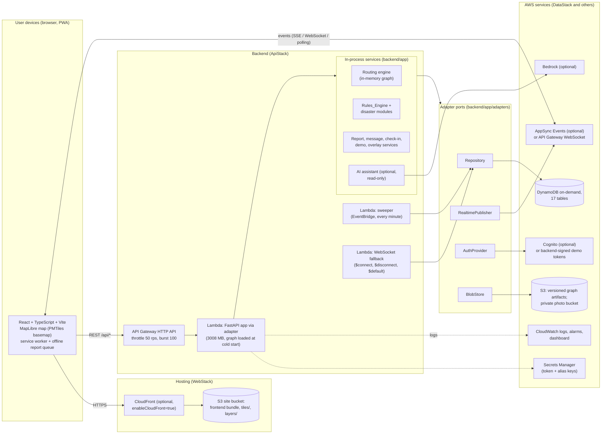
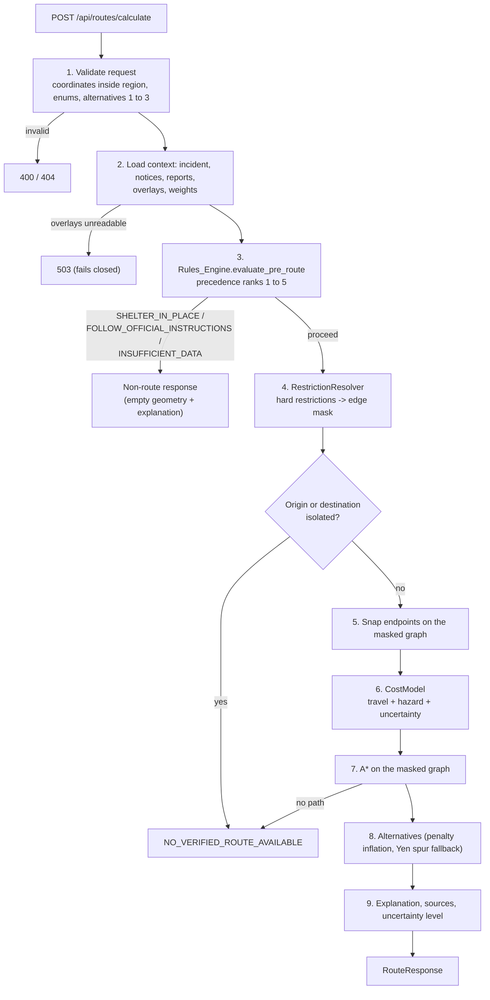
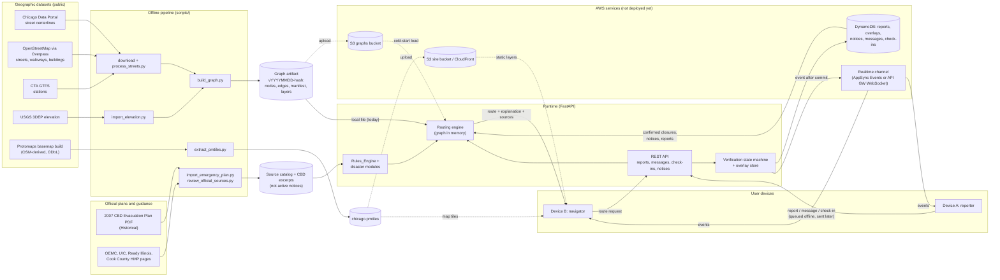
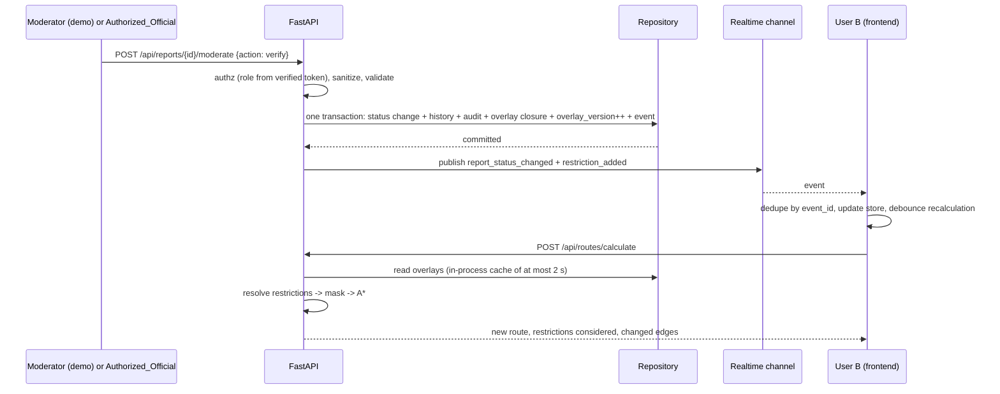
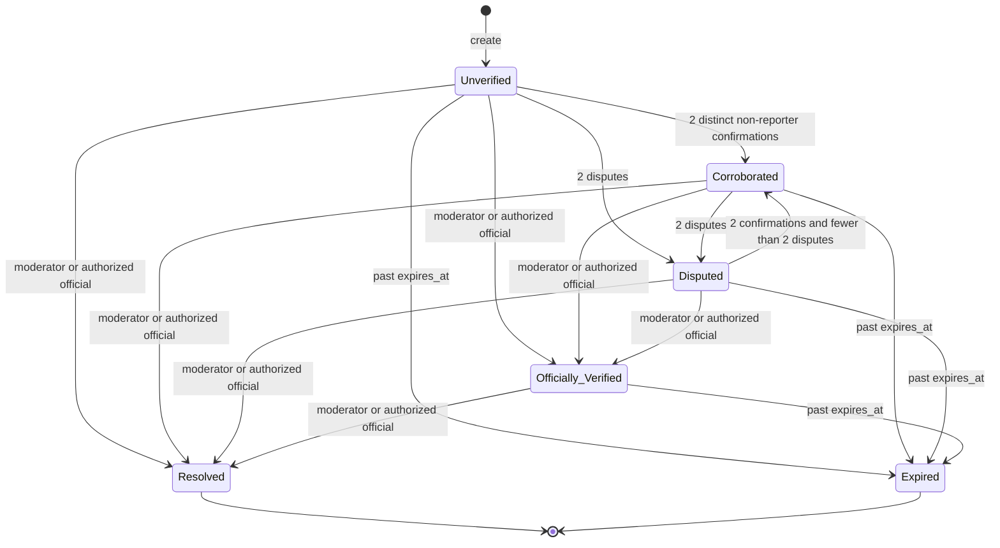

# SafePath architecture

SafePath is an experimental prototype built for a hackathon. It is not an official emergency service, it has no
endorsement from any city or agency, it does not contact 911, and every incident in the demo is simulated. Routes are
algorithm-generated estimates and carry the label `algorithm-generated`.

This document describes what exists in the repository today. Where something is designed but not exercised, it says so.
Nothing has been deployed to AWS from the machine that built this code (see [aws-deployment.md](aws-deployment.md)).

Related documents: [routing-design.md](routing-design.md), [data-sources.md](data-sources.md),
[safety-limitations.md](safety-limitations.md), [api.md](api.md), [aws-deployment.md](aws-deployment.md).

## 1. System context and deployment

The diagram shows the intended AWS deployment (CDK stacks in `infrastructure/aws/`) and, in the same picture, the local
substitutes used today. Solid boxes marked "optional" are off by default in the CDK context flags.

What is real today: the FastAPI app, all four ports with local implementations, the AWS adapters (tested with a fake
DynamoDB client, botocore `Stubber` and locally generated keys), the CDK stacks (`cdk synth` and offline assertion
tests), packaging and deploy scripts (dry-run only). What is not: any run against real AWS.

## 2. Components

| Area | Location | Responsibility |
|---|---|---|
| API | `backend/app/api/` | One router module per area in `api/routers/` (auto-registered), error envelope, body-size cap (1 MB, larger for photo upload), per-user rate limits, text sanitizing |
| Models | `backend/app/models/` | Graph (`Node`, `Edge`), domain records (incident, notice, report, restriction, policy decision), route request/response, privacy helpers (200 m coarsening, aliases) |
| Routing | `backend/app/routing/` | `graph.py` (checksum-verified artifact load, array adjacency, lazy STRtree, snapping), `restrictions.py` (hard step), `cost.py` (soft step and weights), `search.py` (A*), `alternatives.py`, `explain.py`, `indoor.py`, `service.py` (pipeline) |
| Disasters | `backend/app/disasters/` | `rules_engine.py` (policy precedence) and one module per hazard: flood, earthquake, tornado, fire, building |
| Services | `backend/app/services/` | Reports, verification state machine, overlays (closures with an `overlay_version` counter), incidents, sweeper, demo scenarios, optional AI assistant, CTA alerts, graph artifact reader/writer |
| Communication | `backend/app/communication/` | Event bus (events stored first, published after commit), messaging, check-ins with coarse opt-in location |
| Auth | `backend/app/auth/` | Role dependency (`require`), demo-token and Cognito providers, account service, audit writer |
| Adapters | `backend/app/adapters/` | Ports in `ports.py`; local implementations; AWS implementations in `adapters/aws/` |
| Lambda | `backend/app/lambda_handler.py`, `lambda_sweeper.py` | API, sweeper and WebSocket-fallback entry points |
| Frontend | `frontend/src/` | `components`, `pages`, `hooks`, `services` (API client, realtime, offline queue, event store), `maps` (MapLibre layers, PMTiles) and a hand-written service worker in `frontend/public/sw.js` |
| Pipeline | `scripts/` | Download, street merge, elevation, graph build, emergency-plan import, PMTiles extract, fixture graph, OpenAPI export, AWS discovery, packaging, deploy and teardown |
| Infrastructure | `infrastructure/aws/` | CDK (TypeScript): DataStack, ApiStack, WebStack, ObservabilityStack, BudgetStack |
| Data | `data/` | `sources/` (catalog, CBD excerpts, official guidance), `processed/` (graph artifact, reports, tiles), `demo/` (fictional building, scenarios), `raw/` (git-ignored) |

## 3. Adapter ports: local and AWS

The app selects implementations with `SAFEPATH_PROFILE=local|aws`; each port can be overridden individually
(`backend/app/adapters/factory.py`). A missing extra or configuration raises `AdapterNotAvailable` and the dependent
endpoints report unavailable instead of crashing. `GET /api/health` reports the profile.

| Port | Local (default for `local`) | AWS (default for `aws`) | Labeled substitute when the AWS service is unavailable |
|---|---|---|---|
| `Repository` | `MemoryRepository`; `SqliteRepository` optional | `DynamoRepository` (also works against DynamoDB Local) | `sqlite` / `memory`: not durable on Lambda |
| `RealtimePublisher` | `InProcessPublisher` with WebSocket `/ws/incidents/{id}` and SSE `/sse/incidents/{id}` | `AppSyncEventsPublisher` | `ApiGwWebSocketPublisher` (CDK `realtime=apigw-ws`, the CDK default) |
| `AuthProvider` | `DemoTokenAuthProvider` (HMAC-signed tokens, roles from `roles.yaml`) | `CognitoAuthProvider` (JWT, roles from `cognito:groups` only) | demo tokens (`useCognito=false`, the CDK default) |
| `BlobStore` | `LocalBlobStore` (filesystem, signed local URLs) | `S3BlobStore` (presigned PUT/GET, 15 min) | `local`: not usable on Lambda |
| Graph source | `data/processed/graphs/<version>/` (or the SIMULATED fixture under `tests/fixtures/graph`) | `s3://<graphs bucket>/graphs/<version>/` with sha256 check and fallback to bundled data | bundled data |

Write order for every state change: a single `Repository.transact` writes the record, history, audit entry, overlay and
the `Event` row. Only after it commits does the event bus call `RealtimePublisher.publish`. A repository failure maps to
HTTP 503 with nothing persisted and nothing published. A publish failure is logged and never fails the request; clients
recover through `GET /api/events?since=`.

## 4. Request flow

A route request is handled entirely at request time. Nothing is precomputed per route and the AI assistant is never
called, so routing works with the assistant absent or disabled.

Details are in [routing-design.md](routing-design.md).

## 5. Data flow

This is the required data-flow diagram. It covers the geographic datasets, official plans, the routing engine, AWS
services, user devices and the community reporting system. Dashed edges are optional or not exercised against real
AWS yet.

Key points that the diagram does not show:

- Official plans never become live notices. The 2007 plan is Historical, its records carry `cbd_derived=true` and
  `active=false`, and the Rules_Engine excludes `cbd_derived` notices and Cook County HMP boundaries.
- Community reports reach the router in two different ways. Unverified, Corroborated and Disputed reports add soft
  penalties only. A report becomes a hard restriction only after an explicit moderator or authorized-official action
  (`Officially_Verified`).
- The browser never talks to DynamoDB, S3 (except presigned photo URLs) or Bedrock directly.

## 6. Sequence: closure verified, active route recalculated

The 5 s freshness target depends on the in-process overlay cache TTL (2 s) and the channel latency. Measured latency
over a real AppSync or WebSocket deployment does not exist yet.

## 7. Report state machine

Source: `backend/app/services/verification.py`. Thresholds default to 2 and 2. Reports expire after 4 hours by default
(`services/reports.py`). Each change is one transaction with a compare-and-set on the report version, so concurrent
changes apply in receipt order; persistent contention returns HTTP 409. Corroboration cannot produce
`Officially_Verified`. The sweeper (EventBridge, every minute, also `POST /api/admin/sweep`) marks overdue reports
Expired, removes their closure overlays, and scrubs expired check-in locations. Reads also render an overdue report as
Expired before the sweeper has written it.

## 8. Realtime channel

Events carry public views only. The channel is `/safepath/incident/{incident_id}` on AppSync Events, or
`/ws/incidents/{incident_id}` (WebSocket) and `/sse/incidents/{incident_id}` in local mode. `GET /api/events?incident_id=&since=`
returns stored events (24 h TTL) so a client can catch up after a disconnect. The frontend deduplicates by `event_id`,
shows a stale warning after a short disconnect, reconnects with backoff and falls back to polling. See
[safety-limitations.md](safety-limitations.md) for the known mismatch between the frontend WebSocket path and the API
Gateway WebSocket fallback.

## 9. Frontend structure

React + TypeScript + Vite, MapLibre for the map, PMTiles for the basemap. The API client types are generated from
`docs/openapi.json` (`frontend/src/services/api.generated.ts`) with a thin hand-written wrapper (`api.ts`). A hand-written
service worker caches the app shell, the PMTiles basemap (one opt-in download) and a small allowlist of static API data
(layers, sources, regions). Routes, reports, messages, check-ins, events, incidents, notices, auth and photos are never
cached or answered stale. Reports, messages and check-ins made offline are queued on the device (maximum 50) and labeled
"Queued on this device - not sent" until the server accepts them.

## 10. Where to find the numbers

Graph counts, elevation statistics and fallbacks are in `data/processed/summary_report.json` and
`data/processed/fallbacks.json`; they are quoted, with dates, in [routing-design.md](routing-design.md) and
[data-sources.md](data-sources.md). Test results are in [test-results.md](test-results.md).
